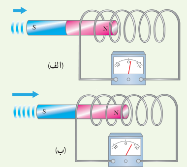
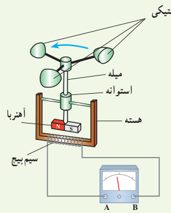
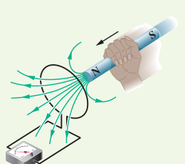
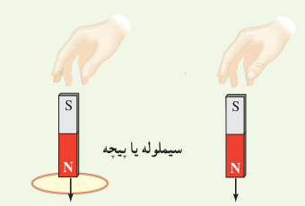
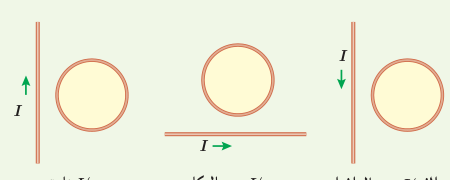

۱۸. دو سیم‌لولۀ مشابه را مطابق شکل‌های زیر به ولت‌سنج حساس وصل کرده‌ایم. دریافت خود را از شکل‌های زیر بنویسید. (آهنرباها مشابه‌اند ولی با تندی متفاوتی به‌طرف سیم‌لوله حرکت می‌کنند.)

۱۹. شکل زیر ساختمان یک بادسنج را نشان می‌دهد. اگر این بادسنج را روی بام خانه نصب کنیم، به هنگام وزیدن باد میلۀ آن می‌چرخد و ولت‌سنج عددی را نشان می‌دهد.

الف) چرا چرخش میله سبب انحراف عقربۀ ولت‌سنج می‌شود؟

ب) آیا با افزایش تندی باد، عددی که ولت‌سنج نشان می‌دهد تغییر می‌کند؟ چرا؟

پ) برای بهبود و افزایش دقت کار دستگاه دو پیشنهاد ارائه دهید.

۲۰. سطح حلقه‌های پیچه‌ای که دارای ۱۰۰۰ حلقه است، عمود بر میدان مغناطیسی یکنواختی که اندازۀ آن $0.040\,\mathrm T$ و جهت آن از راست به چپ است، قرار دارد. میدان مغناطیسی در مدت $0.010\,\mathrm s$ تغییر می‌کند و به $0.040\,\mathrm T$ در خلاف جهت اولیه می‌رسد. اگر سطح هر حلقۀ پیچه $50\,\mathrm{cm^2}$ باشد، اندازۀ نیروی محرکۀ القایی متوسط در پیچه را حساب کنید.

## ۳ـ۹ قانون لنز

۲۱. قطب N یک آهنربا را مطابق شکل زیر به یک حلقۀ رسانا نزدیک می‌کنیم. جهت جریان القایی را در حلقه مشخص کنید.

۲۲. دو آهنربای میله‌ای مشابه را مطابق شکل، به‌طور قائم از ارتفاع معینی نزدیک سطح زمین رها می‌کنیم به‌طوری که یکی از آنها از حلقۀ رسانایی عبور می‌کند. اگر سطح زمین در محل برخورد آهنرباها نرم باشد، مقدار فرورفتگی آهنرباها را در زمین با یکدیگر مقایسه کنید. (تأثیر میدان مغناطیسی زمین روی آهنرباها را نادیده بگیرید.)

۲۳. جهت جریان القایی را در هریک از حلقه‌های رسانای نشان داده شده در شکل‌های زیر تعیین کنید.

