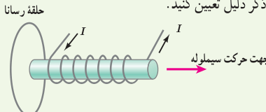
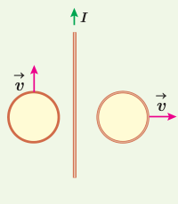
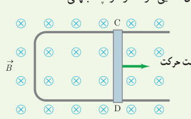
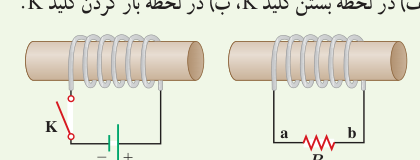
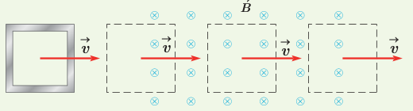
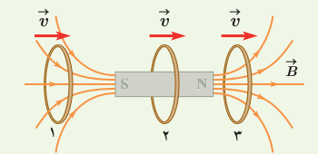
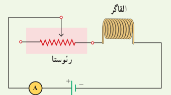

۲۴. شکل زیر سیم‌لولۀ حامل جریانی را نشان می‌دهد که در حال دور شدن از یک حلقۀ رساناست. جهت جریان القایی را در حلقه با ذکر دلیل تعیین کنید.

۲۵. دو حلقۀ رسانا در نزدیکی یک سیم دراز حامل جریان ثابت $I$ قرار دارند؛ این دو حلقه با تندی یکسان، ولی در جهت‌های متفاوت مطابق شکل روبه‌رو حرکت می‌کنند. جهت جریان القایی را در هر حلقه با ذکر دلیل تعیین کنید.

۲۶. شکل زیر رسانای U شکلی را درون میدان مغناطیسی یکنواخت $\vec B$ که عمود بر صفحۀ شکل و رو به داخل صفحه است نشان می‌دهد. وقتی میلۀ فلزی CD به‌طرف راست حرکت کند، جهت جریان القایی در مدار در چه جهتی است؟

۲۷. در مدار نشان داده شده در شکل زیر، جهت جریان القایی را در مقاومت R در هریک از دو حالت زیر با ذکر دلیل پیدا کنید:

الف) در لحظۀ بستن کلید K، ب) در لحظۀ باز کردن کلید K.

۲۸. حلقۀ رسانای مربعی شکل، به طول ضلع $10\,\mathrm{cm}$ وارد میدان مغناطیسی درون‌سویی به اندازۀ $20\,\mathrm{mT}$ و سپس از آن خارج می‌شود.

الف) در کدام مرحله شار عبوری از حلقه بیشینه است؟ مقدار شار گذرنده از حلقه در این حالت چقدر است؟

ب) در کدام وضعیت(ها) شار گذرنده از حلقه تغییر می‌کند؟ جهت جریان القایی را در حلقه تعیین کنید.

۲۹. حلقۀ رسانایی به‌طرف یک آهنربای میله‌ای حرکت می‌کند. شکل زیر، حلقه را در سه وضعیت نسبت به آهنربا نشان می‌دهد. جهت جریان القایی را در حلقه برای هر وضعیت به‌طور جداگانه تعیین کنید.

## ۳ـ۱۰ القاگرها

۳۰. شکل زیر مداری را نشان می‌دهد؛ شامل یک القاگر (سیم‌لوله)، باتری، رئوستا و آمپرسنج که به‌طور متوالی به یکدیگر بسته شده‌اند. اگر بخواهیم بدون تغییر ولتاژ باتری، انرژی ذخیره شده در القاگر را زیاد کنیم چه راهی پیشنهاد می‌کنید؟

## ۳ـ۱۱ جریان متناوب

۳۱. جریان متناوبی که بیشینۀ آن $2.0\,\mathrm A$ و دورۀ آن $0.020\,\mathrm s$ است، از یک رسانای $5.0\,\Omega$ می‌گذرد.

الف) اولین لحظه‌ای که در آن جریان بیشینه است چه لحظه‌ای است؟ در این لحظه نیروی محرکۀ القایی چقدر است؟

ب) در لحظۀ $t=\frac1{400}\,\mathrm s$، جریان چقدر است؟
