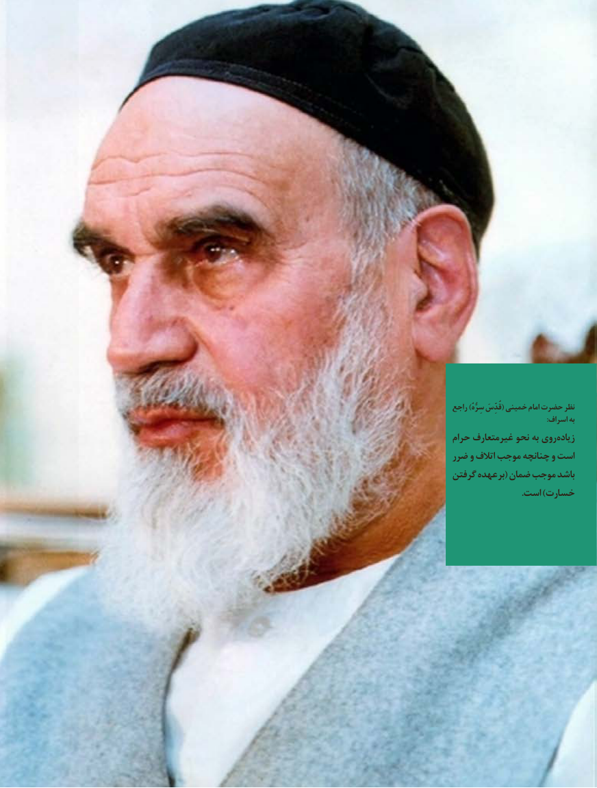

# PDF page 3

راجع )سِرُّهُ قُدِّسَ( خمینی امام حضرت نظر
                                                   :اسراف به
حرام غیرمتعارف نحو به روی زیاده
ضرر و اتالف موجب چنانچه و است
گرفتن عهده بر( ضمان موجب باشد
                               .است )خسارت

