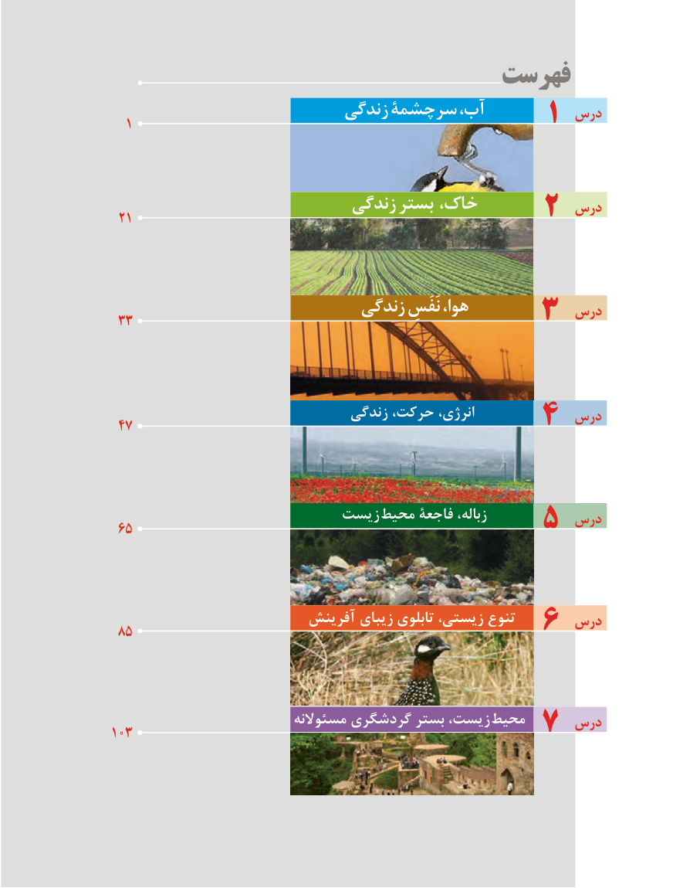

# PDF page 5

فهرست
                          زندگی سرچشمۀ آب،          درس  1                                    1

                           زندگی بستر خاک،           درس 21                           2

                            زندگی نَفَسِ هوا،            درس 33                       3

                               زندگی حرکت، انرژی،           درس 47                        4

                        زیست محیط فاجعۀ زباله،          درس 65                         5

                         آفرینش زیبای تابلوی زیستی، تنوع      درس 85                         6

                           مسئوالنه گردشگری بستر زیست، محیط     درس103                        7

                           5

