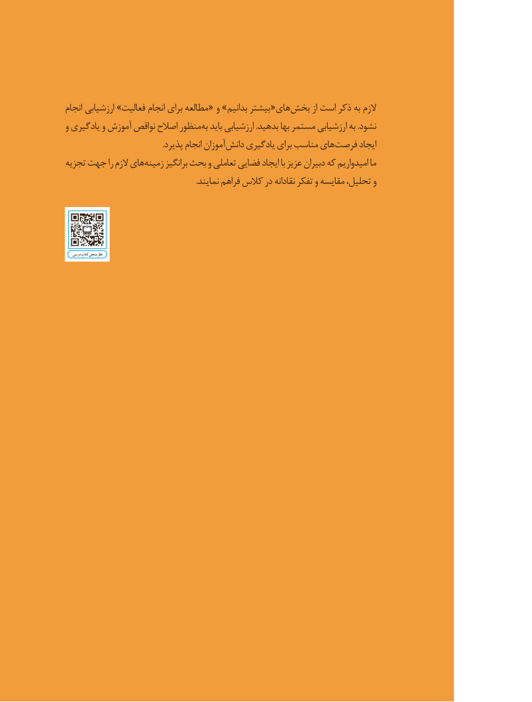

# PDF page 8

انجام ارزشيابي »فعاليت انجام براي مطالعه « و » بدانيم بيشتر «هاي بخش از است ذكر به الزم
و يادگيري و آموزش نواقص اصالح منظور به بايد ارزشيابي .بدهيد بها مستمر ارزشيابي به .نشود
                                                  .پذيرد انجام آموزان دانش يادگيري براي مناسب هاي فرصت ايجاد
تجزيه جهت را الزم هاي زمينه برانگيز بحث و تعاملي فضايي ايجاد با عزيز دبيران كه اميدواريم ما
                                                                   .نمايند فراهم كالس در نقادانه تفكر و مقايسه تحليل، و

    درسی کتاب نظرسنجی

                                8

