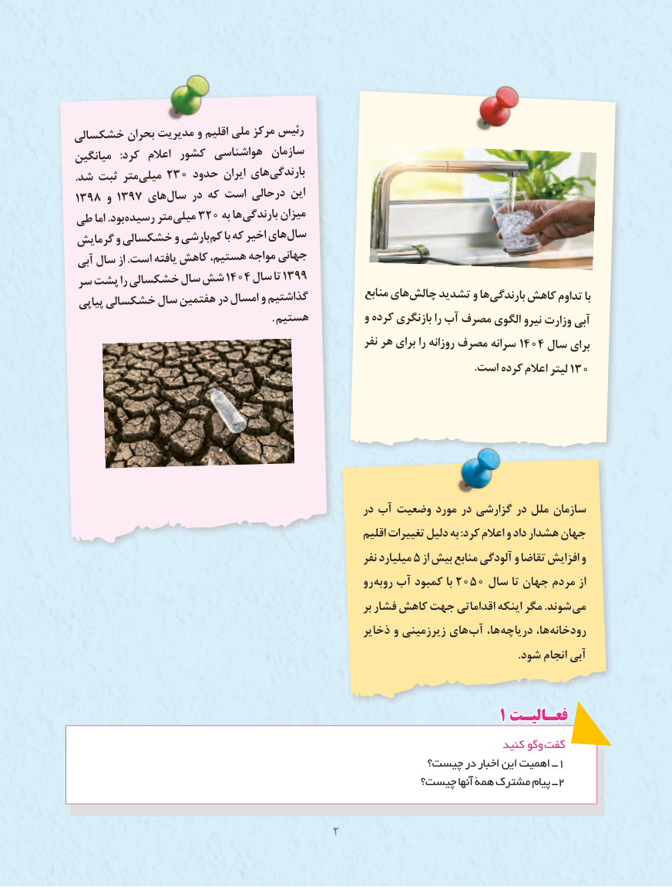

# PDF page 10

خشکسالی بحران مدیریت و اقلیم ملی مرکز رئیس
میانگین  :کرد  اعالم کشور هواشناسی سازمان
.شد ثبت متر میلی٢٣٠ حدود ایران های بارندگی
3198 و 3197 های سال در که است درحالی این
طی اما .بود رسیده متر میلی٢٠٣   به ها بارندگی میزان
گرمایش و خشکسالی و بارشی کم با که اخیر های سال
 آبی سال از .است یافته کاهش هستیم، مواجه جهانی
 سر پشت را خشکسالی سال شش ١٤٠4 سال٩٩تا ٣١
                                                            منابع های چالش تشدید و ها بارندگی کاهش تداوم با پیاپی خشکسالی سال هفتمین در امسال و گذاشتیم
                                                           . هستیم          و کرده بازنگری را آب مصرف الگوی نیرو وزارت آبی
                                                            نفر هر برای را روزانه مصرف سرانه ١٤٠٤ سال برای
                                                                                                                              .است  کرده٠اعالم لیتر ٣١

                                                     در آب وضعیت مورد در گزارشی در ملل سازمان
                                                              اقلیم تغییرات دلیل به :کرد اعالم و داد هشدار جهان
                                                             نفر میلیارد ٥ از بیش منابع آلودگی و تقاضا افزایش و
                                                        رو روبه٢٠٥٠آب کمبود با     سال تا جهان مردم از
                                                                  بر فشار کاهش جهت اقداماتی اینکه مگر .شوند می
                                                     ذخایر و زیرزمینی های آب ها، دریاچه ها، رودخانه
                                                                                                                                                               .شود انجام آبی

                                                               1 فعـالیـتفعـالیـت
                                                                                کنید وگو گفت
                                                 چیست؟ در اخبار این اهمیت ــ 1
                                                چیست؟ آنها همۀ مشترک پیام ــ2

                                      2

