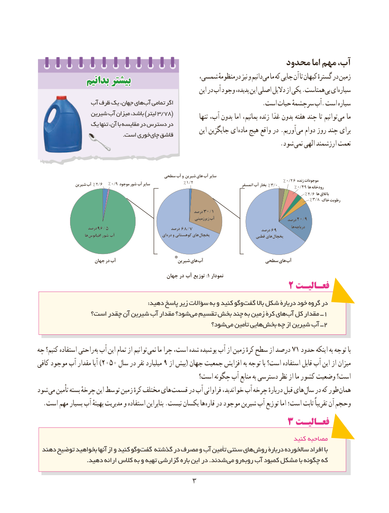

# PDF page 11

محدود اما مهم آب،
             بدانیمبدانیم بیشتربیشتر                  شمسی، درمنظومهٔ نیز و دانیم می ما که جایی آن تا کیهان گسترهٔ در زمین                                                                این در آب وجود پدیده، این اصلی دالیل از یکی .همتاست بی ای سیاره
               آب ظرف یک جهان، های آب تمامی اگر                                                                        .است حیات سرچشمهٔ آب. است سیاره
                شیرین آب میزان باشد، )لیتر 3/78(            تنها آب، بدون اما بمانیم، زنده غذا بدون هفته چند تا توانیم می ما
             یک تنها آن، با مقایسه در دسترس در
                                                               این جایگزین ای ماده هیچ واقع در .آوریم می دوام روز چند برای      . است خوریچای قاشق
                                . شود نمی الهی ارزشمند نعمت

                                            سطحی آب و شیرین های آب سایر
                 شیرین آب % 2/6   % 0/9 موجود شور آب سایر                 % 1/2                         اتمسفر آب بخار % 3/0   % 0/26% 0/49زنده موجوداتها رودخانه
                                                                                                                                        % 2/6 ها باتالق
                                                                                                                                           % 3/8 خاک رطوبت

                                                                      درصد 30 /1
                                                                                      زیرزمینی آب                                 درصد 20 /9
                       درصد 96 / 5                            درصد 68 / 7                               درصد 69         هادریاچه
                            ها اقیانوس شور آب                        ای دره و کوهستانی های یخچال                     قطبی های یخچال

                       جهان در آب     * شیرین هایآب                   سطحی های آب

                                             جهان در آب توزیع 1: نمودار
                                                  2 فعـالیـتفعـالیـت
                                                      :دهید پاسخ زیر سؤاالت به و کنید وگو گفت باال شکل دربارۀ خود گروه در
             است؟ چقدر آن شیرین آب مقدار شود؟ می تقسیم بخش چند به زمین کرۀ های آب کل مقدار ــ1
                                                شود؟ می تأمین هایی بخش چه از شیرین آب ــ 2

چه کنیم؟ استفاده راحتی به آب این تمام از توانیم نمی۷۱ما چرا است، شده پوشیده آب از زمین کرهٔ سطح از درصد   حدود اینکه به توجه با
کافی موجود آب مقدار آیا )2050 سال در نفر میلیارد 9 از بیش( جهان جمعیت افزایش به توجه با است؟ استفاده قابل آب این از میزان
                                             است؟ چگونه آب منابع به دسترسی نظر از ما کشور وضعیت است؟
شود می تأمین بسته چرخهٔ این توسط زمین کرهٔ مختلف های قسمت در آب فراوانی خواندید، آب چرخه دربارهٔ قبل های سال در که طور همان
. است مهم بسیار آب بهینهٔ مدیریت و استفاده بنابراین .نیست یکسان ها قاره در موجود شیرین آب توزیع اما است؛ ثابت تقریباً آن وحجم
                                         3 فعـالیـتفعـالیـت
                                                                                  کنید مصاحبه
 دهند توضیح بخواهید آنها از و کنید وگو گفت گذشته در مصرف و آب تأمین سنتی های روش دربارۀ سالخورده افراد با
 . دهید ارائه کالس به و تهیه گزارشی باره این در .شدند می رو روبه آب کمبود مشکل با چگونه که

                                  3

