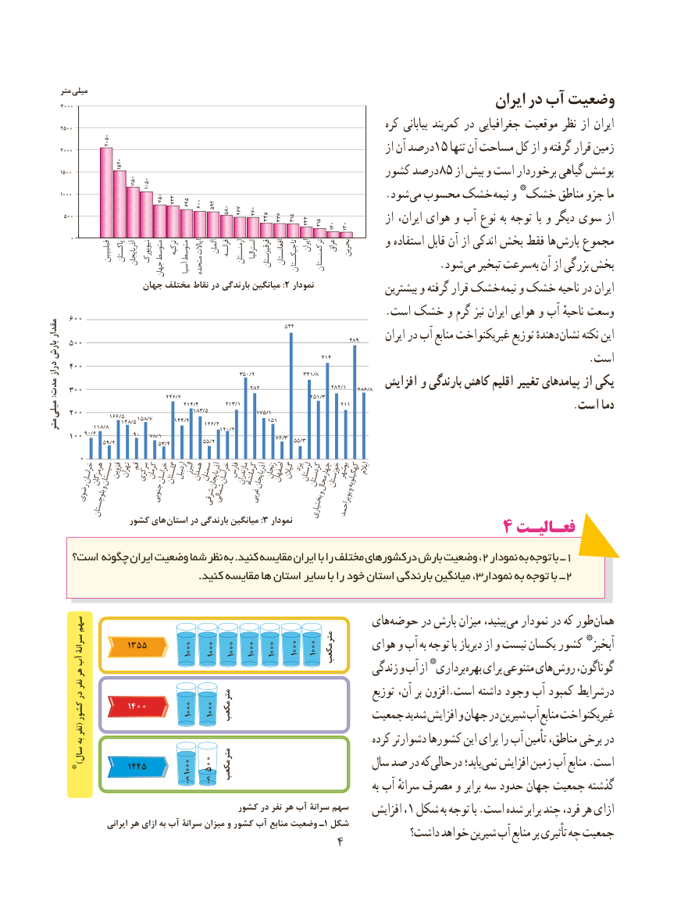

# PDF page 12

متر میلی                                                                  ایران در آب وضعیت
                                                                           کره بیابانی کمربند در جغرافیایی موقعیت نظر از ایران
                                                                               از آن درصد15 تنها آن مساحت کل از و گرفته قرار زمین
                                                      کشور درصد 85 از بیش و است برخوردار گیاهی پوشش
                                                               *                                                              .شود می محسوب خشک نیمه و خشک مناطق جزو ما
                                                                               از ایران، هوای و آب نوع به توجه با و دیگر سوی از
                                                               و استفاده قابل آن از اندکی بخش فقط ها بارش مجموع                            فیلیپین پاکستانآذربایجان نیویورکمتوسط ترکیهمتوسطایاالت آلمانفرانسه ارمنستاناسترالیا قرقیزستانافغانستان     ایرانترکمنستاعراق بحرین                                                                                                                                                             تاجیکستان ن                              . شود می تبخیر سرعت به آن از بزرگی بخش                               جهان    آسیامتحده
                    جهان مختلف نقاط در بارندگی میانگین :2 نمودار                                                                          بیشترین و گرفته قرار خشک نیمه و خشک ناحیه در ایران
     600                                                         .است خشک و گرم نیز ایران هوایی و آب ناحیهٔ وسعت
                                                                               90/6مقدار                                                                    544     500                                                                                 489       ایران در آب منابع غیریکنواخت توزیع دهندهٔ نشان نکته این
بارش                                                                               414     400                                                                                               .استدراز                                                          350/2                341/8

                                                              282                                                                                             282/1    286/8  افزایش و بارندگی کاهش اقلیم تغییر پیامدهای از یکی     300مدت:                                       246/6                                                                                      251/3

                                                183/5                                                                     175/1                                                                                                          .است دما     200میلی                                        214/4         213/1                              211                     166/5
                                                                    151                         148/5 158/7       144/2                                                    126/2                118/8متر                                                         120/2
                           90   78/1     100 90/6
                   59/2                                     53/4           55/2                    76/3  55/3

        0
           خراسانهرمزگان                سیستانقزوینتهرانقممرکزیکرمانخراسانگلستاناردبیلالبرزهمدانسمنانآذربایجانخراسانفارسمازندرانکرمانشاهآذربایجانزنجاناصفهانگیالنیزدلرستانکردستان    و                                                                                                         چهارمحالخوزستانبوشهروکهگیلویهایالم                   و       رضوی                جنوبی        شرقیشمالی    غربی                 بلوچستان                                                                        بختیاری    بویراحمد
                 کشور های  3:استان در بارندگی میانگین   نمودار                     ۴ فعـالیـتفعـالیـت
    است؟ چگونه ایران وضعیت شما نظر به .کنید مقایسه ایران با را مختلف درکشورهای بارش وضعیت ،2 نمودار به توجه با ــ1
                                           .کنید مقایسه ها استان سایر با را خود استان بارندگی میانگین ، 3نمودار به توجه با ــ 2

     سهم                                                های حوضه در بارش میزان بینید، می نمودار در که طور همان
                                                    متر                                                                       *        سرانۀ        3155                                             1000 1000 1000  1000 1000         هوای و آب به توجه با دیرباز از و نیست یکسان کشور  آبخیز   آب                                                           مکعب                                                   *
   هر                                                               زندگی و آب از  برداری بهره برای متنوعی های روش گوناگون،
     نفر
   در                         متر                                                                          توزیع آن، بر افزون.است داشته وجود آب کمبود درشرایط                 1400                           10001000       کشور                                 مکعب  (                                             جمعیت شدید افزایش و جهان در شیرین آب منابع غیریکنواخت
     نفر
   به                                                                       کرده دشوارتر کشورها این برای را آب تأمین مناطق، برخی در
     سال                         متر  )*         1445                        100010001000 500                           سال صد در که حالی در یابد؛ نمی افزایش زمین آب منابع .است                                            مکعب
                                    ؟    ؟                                               به آب سرانهٔ مصرف و برابر سه حدود جهان جمعیت گذشته
                                      کشور در نفر هر آب سرانۀ سهم                                                                  افزایش ،1 شکل به توجه با .است شده برابر چند فرد، هر ازای
                  ایرانی هر ازای به آب سرانۀ میزان و کشور آب منابع وضعیت ـ 1 شکل          داشت؟ خواهد شیرین آب منابع بر تأثیری چه جمعیت                                         4

