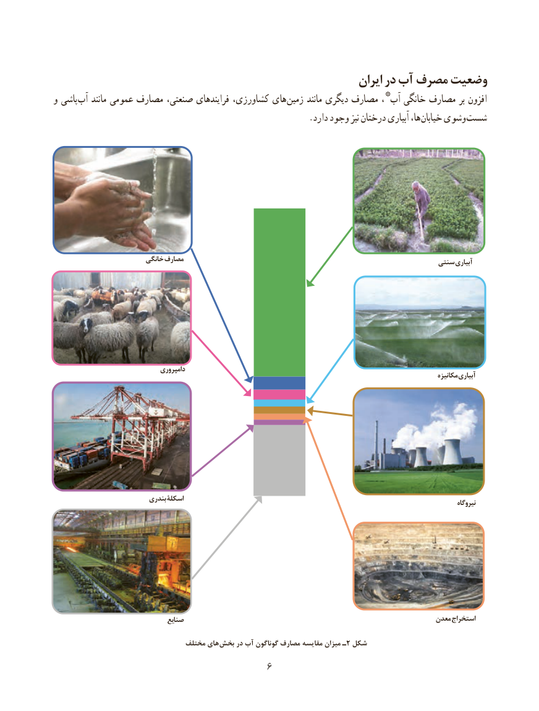

# PDF page 14

ایران در آب مصرف وضعیت
                                                       *و پاشی آب مانند عمومی مصارف صنعتی، فرایندهای کشاورزی، های زمین مانند دیگری مصارف ، آب خانگی مصارف بر افزون
    . دارد وجود نیز درختان آبیاری ها، خیابان وشوی شست

                         خانگی مصارف                                                                                            سنتی آبیاری

                                  دامپروری                                                                                                                                   مكانیزه آبیاری

                           بندری اسکلۀ                                                                                                                                                      نیروگاه

                                  صنایع                                                                 معدن استخراج

                                 مختلف های بخش در آب گوناگون مصارف مقایسه میزان ـ 2 شکل
                                       6

