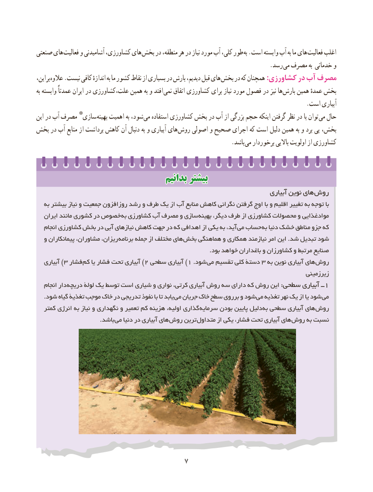

# PDF page 15

صنعتی های فعالیت و آشامیدنی کشاورزی، های بخش در منطقه، هر در نیاز مورد آب کلی، طور به .است وابسته آب به ما های فعالیت اغلب
                                                                              .رسد می مصرف به خدماتی و
این، بر عالوه .نیست کافی اندازهٔ به ما کشور نقاط از بسیاری در بارش دیدیم، قبل های بخش در که همچنان :کشاورزی در آب مصرف
به وابسته عمدتاً ایران در علت،کشاورزی همین به و افتد نمی اتفاق کشاورزی برای نیاز مورد فصول در نیز ها بارش همین عمدهٔ بخش
                                                                                          .است آبیاری
          *این در آب مصرف  سازی بهینه اهمیت به شود، می استفاده کشاورزی بخش در آب از بزرگی حجم اینکه گرفتن نظر در با توان می حال
بخش در آب منابع از برداشت کاهش آن دنبال به و آبیاری های روش اصولی و صحیح اجرای که است دلیل همین به و برد پی بخش،
                                                                 .باشد می برخوردار باالیی اولویت از کشاورزی

                                    بدانیمبدانیم بیشتربیشتر
                                                                                  آبیاری نوین های روش
   به بیشتر نیاز و جمعیت روزافزون رشد و طرف یک از آب منابع کاهش نگرانی گرفتن اوج با و اقلیم تغییر به توجه با
   ایران مانند کشوری در خصوص به کشاورزی آب مصرف و سازی بهینه دیگر، طرف از کشاورزی محصوالت و موادغذایی
   انجام کشاورزی بخش در آبی نیازهای کاهش جهت در که اهدافی از یکی به آید، می حساب به دنیا خشک مناطق جزو که
  و پیمانکاران مشاوران، ریزان، برنامه جمله از مختلف های بخش هماهنگی و همکاری نیازمند امر این .شد تبدیل شود
                                                                                         .بود خواهد باغداران و کشاورزان و مرتبط صنایع
   آبیاری ) ٣ فشار )کم٢یا فشار تحت آبیاری سطحی١آبیاری )   .شود می٣تقسیم کلی دستۀ   به نوین آبیاری های روش
                                                                                            زیرزمینی
   انجام دار دریچه١لولۀ یک توسط است شیاری و نواری کرتی، آبیاری روش سه دارای که روش این :سطحی آبیاری ــ
    .شود گیاه تغذیۀ موجب خاک در تدریجی نفوذ با تا یابد می جریان خاک سطح برروی و شود می تغذیه نهر یک از یا شود می
   کمتر انرژی به نیاز و نگهداری و تعمیر کم هزینه اولیه، گذاری سرمایه بودن پایین دلیل به سطحی آبیاری های روش
                                 .باشد می دنیا در آبیاری های روش ترین متداول از یکی فشار، تحت آبیاری های روش به نسبت

                                   7

