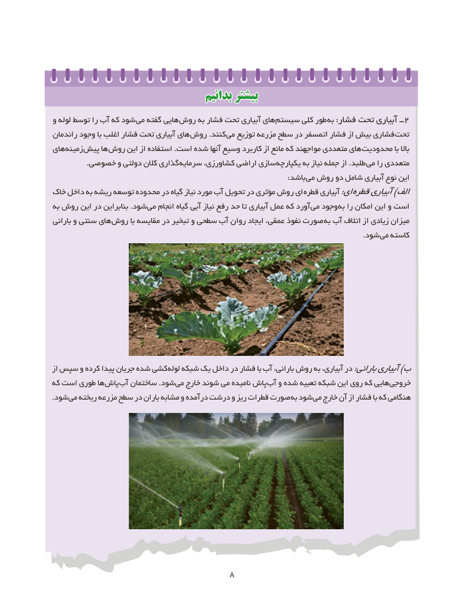

# PDF page 16

بدانیمبدانیم بیشتربیشتر
و لوله توسط را آب که شود می گفته هایی روش به فشار تحت آبیاری های سیستم کلی طور به٢:فشار تحت آبیاری ــ
راندمان وجود با اغلب فشار تحت آبیاری های روش .کنند می توزیع مزرعه سطح در اتمسفر فشار از بیش فشاری تحت
های زمینه پیش ها روش این از استفاده .است شده آنها وسیع کاربرد از مانع که مواجهند متعددی های محدودیت با باال
              .خصوصی و دولتی کالن گذاری سرمایه کشاورزی، اراضی سازی یکپارچه به نیاز جمله از .طلبد می را متعددی
                                                                                                  :باشد می روش دو شامل آبیاری نوع این
خاک داخل به ریشه توسعه محدوده در گیاه نیاز مورد آب تحویل در مؤثری روش ای قطره آبیاری:ای قطرهآبیاری)الف
به روش این در بنابراین .شود می انجام گیاه آبی نیاز رفع حد تا آبیاری عمل که آورد می وجود به را امکان این و است
بارانی و سنتی های روش با مقایسه در تبخیر و سطحی آب روان ایجاد عمقی، نفوذ صورت به آب اتالف از زیادی میزان
                                                                                                                                 .شود می کاسته

از سپس و کرده پیدا جریان شده کشی لوله شبکه یک داخل در فشار با آب بارانی، روش به آبیاری، در:بارانیآبیاری)ب
که است طوری ها پاش آب ساختمان .شود می خارج شوند می نامیده پاش آب و شده تعبیه شبکه این روی که هایی خروجی
.شود می ریخته مزرعه سطح در باران مشابه و درآمده درشت و ریز قطرات صورت به شود می خارج آن از فشار با که هنگامی

                                 8

