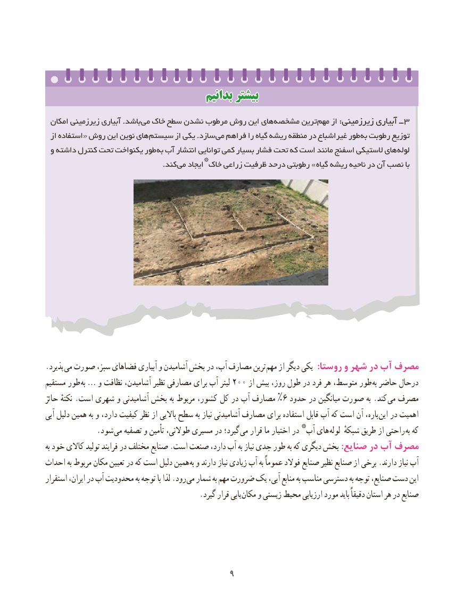

# PDF page 17

بدانیمبدانیم بیشتربیشتر

 امکان زیرزمینی آبیاری .باشد می خاک سطح نشدن مرطوب روش این های مشخصه ترین مهم از :زیرزمینی آبیاری ــ ٣
  از استفاده « روش این نوین های سیستم از یکی .سازد می فراهم را گیاه ریشه منطقه در غیراشباع طور به رطوبت توزیع
 و داشته کنترل تحت یکنواخت طور به آب انتشار توانایی کمی بسیار فشار تحت که است مانند اسفنج الستیکی های لوله
                               *                                                 .کند »می ایجاد خاک زراعی ظرفیت درحد رطوبتی    گیاه ریشه ناحیه در آن نصب با

.پذیرد می صورت سبز، فضاهای آبیاری و آشامیدن بخش در آب، مصارف ترین مهم از دیگر یکی  :روستا و شهر در آب مصرف
مستقیم طور به … و نظافت آشامیدن، نظیر مصارفی برای آب لیتر 200 از بیش روز، طول در فرد هر متوسط، طور به حاضر درحال
حائز نکتهٔ .است شهری و آشامیدنی بخش به مربوط کشور، کل در آب مصارف %6 حدود در میانگین صورت به .کند می مصرف
آبی دلیل همین به و دارد، کیفیت نظر از باالیی سطح به نیاز آشامیدنی مصارف برای استفاده قابل آب که است آن باره، این در اهمیت
                                                  *      . شود می تصفیه و تأمین طوالنی، مسیری در گیرد؛ می قرار ما اختیار در  آب های لوله شبکهٔ طریق از راحتی به که
به خود کاالی تولید فرایند در مختلف صنایع .است صنعت دارد، آب به نیاز جدی طور به که دیگری بخش :صنایع در آب مصرف
احداث به مربوط مکان تعیین در که است دلیل همین به و دارند نیاز زیادی آب به عموماً فوالد صنایع نظیر صنایع از برخی .دارند نیاز آب
استقرار ایران، در آب محدودیت به توجه با لذا .رود می شمار به مهم ضرورت یک آبی، منابع به مناسب دسترسی به توجه صنایع، دست این
       . گیرد قرار یابی مکان و زیستی  محیط ارزیابی مورد باید دقیقاً استان هر در صنایع

                                        9

