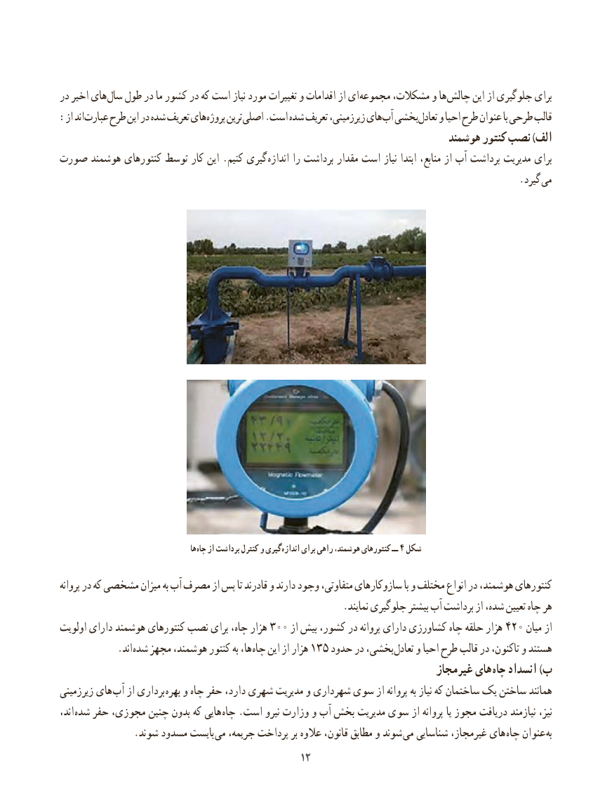

# PDF page 20

در اخیر های سال طول در ما کشور در که است نیاز مورد تغییرات و اقدامات از ای مجموعه مشکالت، و ها چالش این از جلوگیری برای
: از اند عبارت طرح این در شده تعریف های پروژه ترین اصلی .است شده تعریف زیرزمینی، های آب بخشی تعادل و احیا طرح عنوان با طرحی قالب
                                                                         هوشمند کنتور نصب )الف
صورت هوشمند کنتورهای توسط کار این .کنیم گیری  اندازه را برداشت مقدار است نیاز ابتدا منابع، از آب برداشت مدیریت برای
                                      . گیرد می

                                            ها چاه از برداشت کنترل و گیری اندازه برای راهی هوشمند، کنتورهای ــ ٤ شکل

پروانه در که مشخصی میزان به آب مصرف از پس تا قادرند و دارند وجود متفاوتی، سازوکارهای با و مختلف انواع در هوشمند، کنتورهای
                                                          .نمایند جلوگیری بیشتر آب برداشت از شده، تعیین چاه هر
اولویت دارای هوشمند کنتورهای نصب برای چاه، هزار ٠٠٣ از بیش کشور، در پروانه دارای کشاورزی چاه حلقه هزار ٠٢٤ میان از
       . اند شده مجهز هوشمند، کنتور به ها، چاه این از هزار 135 حدود در بخشی، تعادل و احیا طرح قالب در تاکنون، و هستند
                                                                        غیرمجاز های  چاه انسداد )ب
زیرزمینی های آب از برداری بهره و چاه حفر دارد، شهری مدیریت و شهرداری سوی از پروانه به نیاز که ساختمان یک ساختن همانند
اند، شده حفر مجوزی، چنین بدون که هایی  چاه .است نیرو وزارت و آب بخش مدیریت سوی از پروانه یا مجوز دریافت نیازمند نیز،
  . شوند مسدود بایست می جریمه، پرداخت بر عالوه قانون، مطابق و شوند می شناسایی غیرمجاز، های چاه عنوان به
                                                                                            1212

