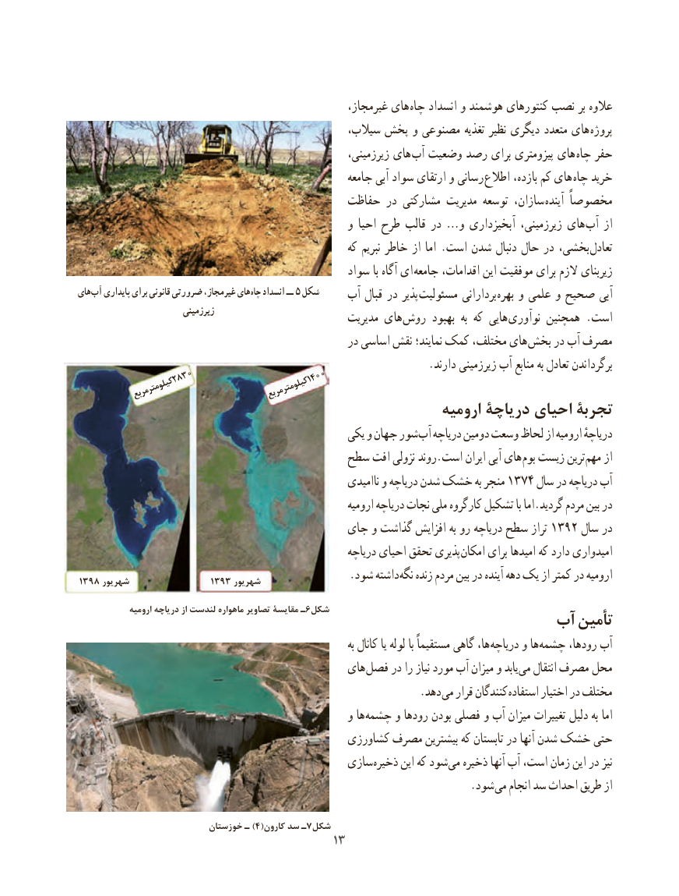

# PDF page 21

غیرمجاز، های چاه انسداد و هوشمند کنتورهای نصب بر عالوه
                                                 سیالب، پخش و مصنوعی تغذیه نظیر دیگری متعدد های پروژه
                                                          زیرزمینی، های آب وضعیت رصد برای پیزومتری های  چاه حفر
                                                      جامعه آبی سواد ارتقای و رسانی اطالع بازده، کم های  چاه خرید
                                         حفاظت در مشارکتی مدیریت توسعه سازان، آینده مخصوصاً
                                                  و احیا طرح قالب در …و آبخیزداری زیرزمینی، های آب از
                                                        که نبریم خاطر از اما .است شدن دنبال حال در بخشی، تعادل
                                                 سواد با آگاه ای  جامعه اقدامات، این موفقیت برای الزم زیربنای
های آب پایداری برای قانونی ضرورتی غیرمجاز، های چاه انسداد ــ ٥ شکل    آب قبال در پذیر مسئولیت بردارانی  بهره و علمی و صحیح آبی
                           زیرزمینی                          مدیریت های  روش بهبود  به که هایی نوآوری همچنین .است
                                                  در اساسی نقش نمایند؛ کمک مختلف، های بخش در آب مصرف
                                                                .دارند زیرزمینی آب منابع به تعادل برگرداندن              2830            1400               کیلومتر                     کیلومترمربع          مربع
                                                       ارومیه دریاچۀ احیای تجربۀ
                                               یکی و جهان شور آب دریاچه دومین وسعت لحاظ از ارومیه دریاچهٔ
                                     سطح افت نزولی روند.است ایران آبی های بوم زیست ترین مهم از
                                                            ناامیدی و دریاچه شدن خشک به منجر 1374 سال در دریاچه آب
                                                              ارومیه دریاچه نجات ملی کارگروه تشکیل با اما.گردید مردم بین در
                                       جای و گذاشت افزایش به رو دریاچه سطح تراز 1392 سال در
                                                         دریاچه احیای تحقق پذیری امکان برای امیدها که دارد امیدواری
3198 شهریور                3193 شهریور   . شود داشته نگه زنده مردم بین در آینده دهه یک از کمتر در ارومیه

              ارومیه دریاچه از لندست ماهواره تصاویر مقایسۀ ـ6شکل
                                                آب تأمین
                                                                               به کانال یا لوله با مستقیماً گاهی ها، دریاچه و ها چشمه رودها، آب
                                             های فصل در را نیاز مورد آب میزان و یابد می انتقال مصرف محل
                            . دهد می قرار کنندگان استفاده اختیار در مختلف
                                                  و ها چشمه و رودها بودن فصلی و آب میزان تغییرات دلیل به اما
                                             کشاورزی مصرف بیشترین که تابستان در آنها شدن خشک حتی
                                           سازی ذخیره این که شود می ذخیره آنها آب است، زمان این در نیز
                              . شود می انجام سد احداث طریق از

                    خوزستان۴ـ )  (کارون سد ـ7شکل
                                                                                3131

