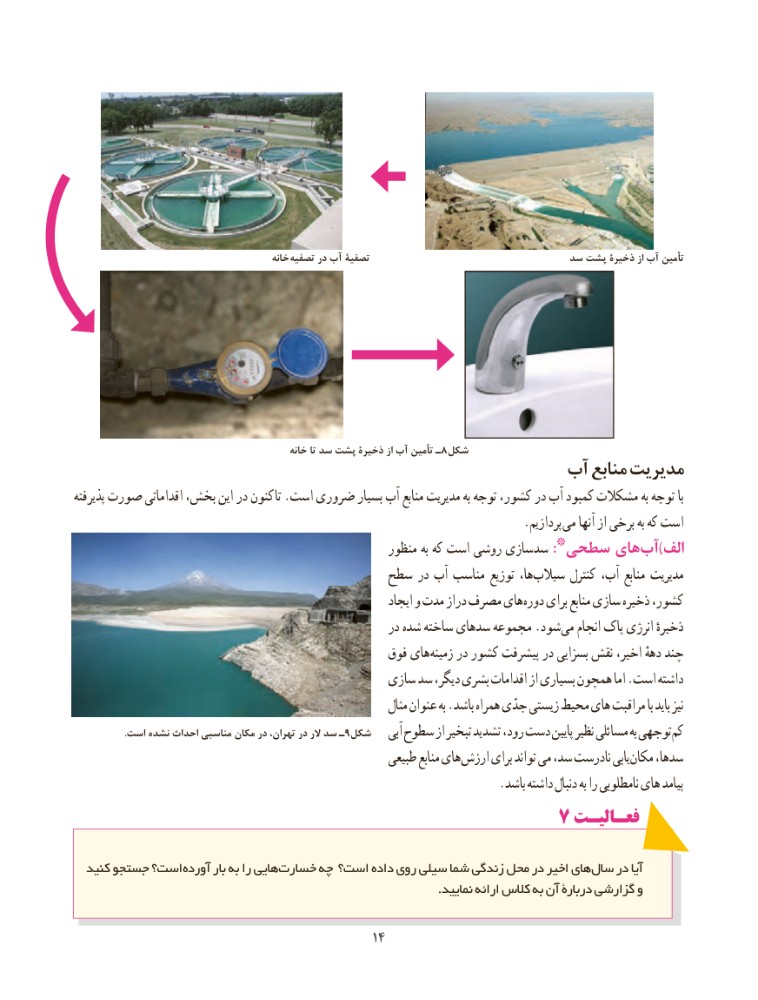

# PDF page 22

خانه تصفیه در آب تصفیۀ                             سد پشت ذخیرۀ از آب تأمین

                                                 خانه تا سد پشت ذخیرۀ از آب تأمین ـ8شکل
                                            آب منابع مدیریت
پذیرفته صورت اقداماتی بخش، این در کنون تا .است ضروری بسیار آب منابع مدیریت به توجه کشور، در آب کمبود مشکالت به توجه با
                      . پردازیم می آنها از برخی به که است
                                                      منظور به که است روشی سازی سد *:سطحی های آب)الف
                                      سطح در آب مناسب توزیع ها، سیالب کنترل آب، منابع مدیریت
                                                                ایجاد و مدت دراز مصرف های دوره برای منابع سازی ذخیره کشور،
                                                      در شده ساخته سدهای مجموعه .شود می انجام پاک انرژی ذخیرهٔ
                                                 فوق های زمینه در کشور پیشرفت در بسزایی نقش اخیر، دههٔ چند
                                             سازی سد دیگر، بشری اقدامات از بسیاری همچون اما .است داشته
                                                                مثال عنوان به .باشد همراه جدّی زیستی محیط های مراقبت با باید نیز
                     .است نشده احداث مناسبی مکان در تهران، در الر سد ـ9شکل    آبی سطوح از تبخیر تشدید رود، دست پایین نظیر مسائلی به توجهی کم
                                                       طبیعی منابع های ارزش برای تواند می سد، نادرست یابی مکان سدها،
                                                                      .باشد داشته دنبال به را نامطلوبی های پیامد
                                           7 فعـالیـتفعـالیـت

  کنید جستجو است؟ آورده بار به را هایی خسارت چه است؟ داده روی سیلی شما زندگی محل در اخیر های سال در آیا
                                                                                            .نمایید ارائه کالس به آن دربارۀ گزارشی و

                                                                                          1414

