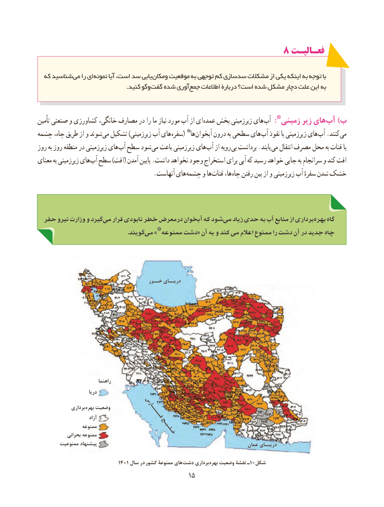

# PDF page 23

8 فعـالیـتفعـالیـت

  که شناسید می را ای نمونه آیا است، سد یابی ومکان موقعیت به توجهی کم سدسازی مشکالت از یکی اینکه به توجه با
       . کنید وگوگفت شده آوری جمع اطالعات دربارۀ است؟ شده مشکل دچار علت این به

تأمین صنعتی و کشاورزی خانگی، مصارف در را ما نیاز مورد آب از ای عمده بخش زیرزمینی های آب *:زمینی زیر های آب )ب
چشمه چاه، طریق از و شوند می تشکیل )زیرزمینی آب های سفره( *ها آبخوان درون به سطحی های آب نفوذ با زیرزمینی های آب .کنند می
روز به روز منطقه در زیرزمینی های آب سطح شود می باعث زمینی زیر های آب از رویه بی برداشت .یابند می انتقال مصرف محل به قنات یا
معنای به زیرزمینی های آب سطح )افت( آمدن پایین .داشت نخواهد وجود استخراج برای آبی که رسید خواهد جایی به سرانجام و کند افت
       . آنهاست های چشمه و ها قنات ها، چاه رفتن بین از و زیرزمینی آب سفرهٔ شدن خشک

 حفر نیرو وزارت و گیرد می قرار نابودی خطر درمعرض آبخوان که شود می زیاد حدی به آب منابع از برداری بهره گاه
                                                      .گویند می *»ممنوعه دشت« آن به و کند می اعالم ممنوع را دشت آن در جدید چاه

                                         خــزر دریــای

                             راهنما
                         دریا

               برداری  بهره وضعیت                                          فـــــارس                          آزاد
                  ممنوعه                                            خـلـیـج             بحرانی ممنوعه
        ممنوعیت پیشنهاد                                                         عمان دریــای

                               1401 سال در  کشور ممنوعۀ های دشت برداری  بهره وضعیت نقشۀ ـ10شکل
                                           1515

