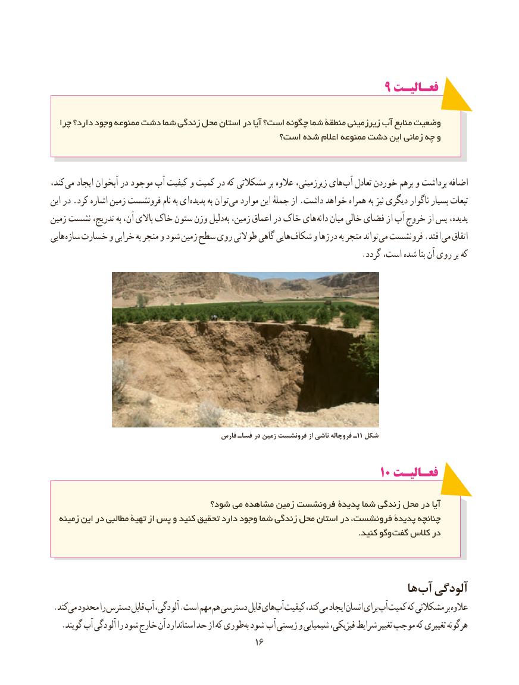

# PDF page 24

9 فعـالیـتفعـالیـت

  چرا دارد؟ وجود ممنوعه دشت شما زندگی محل استان در آیا است؟ چگونه شما منطقۀ زیرزمینی آب منابع وضعیت
                                          است؟ شده اعالم ممنوعه دشت این زمانی چه و

،کند می ایجاد آبخوان در موجود آب کیفیت و کمیت در که مشکالتی بر عالوه زیرزمینی، های آب تعادل خوردن برهم و برداشت اضافه
این در .کرد اشاره زمین فرونشست نام به ای پدیده به توان می موارد این جملهٔ از .داشت خواهد همراه  به نیز دیگری ناگوار بسیار تبعات
زمین نشست تدریج، به آن، باالی خاک ستون وزن دلیل به زمین، اعماق در خاک های دانه میان خالی فضای از آب خروج از پس پدیده،
هایی سازه خسارت و خرابی به منجر و شود زمین سطح روی طوالنی گاهی هایی شکاف و درزها به منجر تواند می نشست فرو .افتد می اتفاق
                                                                           .گردد است، شده بنا آن روی بر که

                                             فارس فساـ در زمین فرونشست از ناشی فروچاله ـ11 شکل

                                                             1010 فعـالیـتفعـالیـت

                                شود؟ می مشاهده زمین فرونشست پدیدۀ شما زندگی محل در آیا
  زمینه این در مطالبی تهیۀ از پس و کنید تحقیق دارد وجود شما زندگی محل استان در نشست، فرو پدیدۀ چنانچه
                 . کنید وگو گفت کالس در

                                                                     ها آب آلودگی
 .کند می محدود را دسترس قابل آب آلودگی، .است مهم هم دسترسی قابل های آب کیفیت کند، می ایجاد انسان برای آب کمیت که مشکالتی بر عالوه
. گویند آب آلودگی را شود خارج آن استاندارد حد از که طوریبه شود آب زیستی و شیمیایی فیزیکی، شرایط تغییر موجب که تغییری هرگونه
                                                                                           1616

