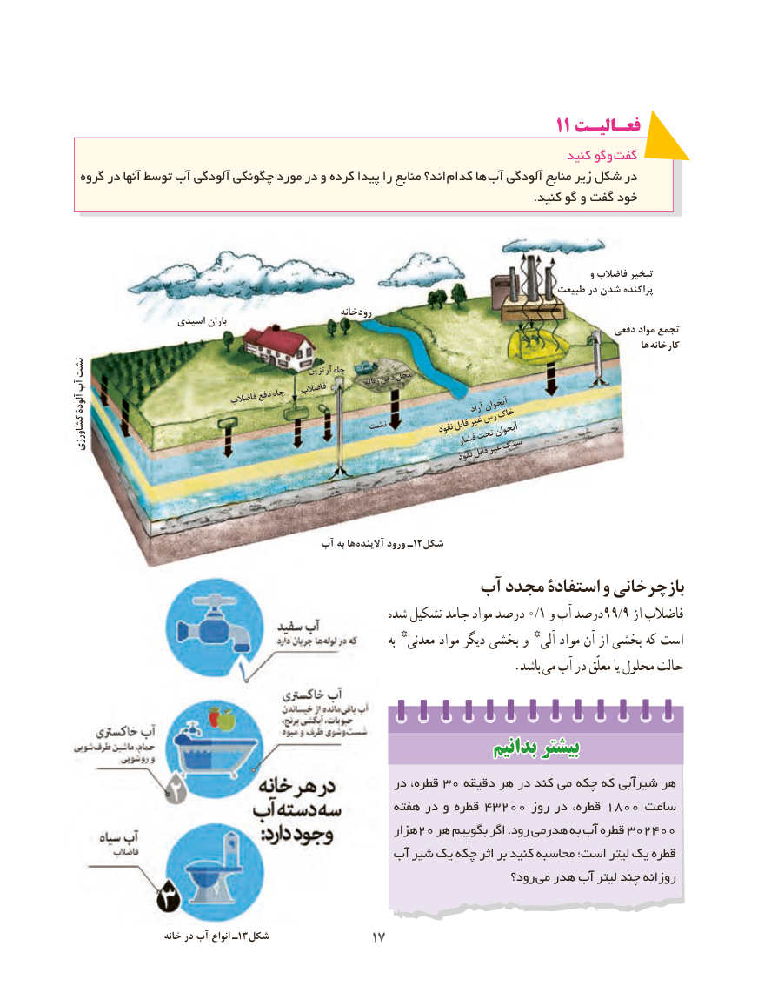

# PDF page 25

1111 فعـالیـتفعـالیـت
                                                                                  کنید وگو گفت
  گروه در آنها توسط آب آلودگی چگونگی مورد در و کرده پیدا را منابع اند؟ کدام ها آب آلودگی منابع زیر شکل در
                                                                                                                     .کنید گو و گفت خود

                                                                                                                    و فاضالب تبخیر
                                                                                       طبیعت در شدن پراکنده
                                                            رودخانه                   اسیدی باران                                                                                                      دفعی مواد تجمع
                                                                                                                                       ها کارخانه
نشت                                                       آرتزین چاه
آب                                                                             زبالهدفنمحل                                                فاضالب                                  دفعچاه                                 فاضالبآلودۀ                                                                                                آزادآبخوان                                                             خاک
                                           نشت          نفوذقابلغیررسآبخوان                                                         تحت                                                                          فشارکشاورزی                                                       سنگ                                                                                        قابلغیر                                                                                    نفوذ

                                       آب به ها آالینده ورود ـ12شکل
                                     آب مجدد استفادۀ و بازچرخانی
                                                  شده تشكیل جامد مواد درصد 0/1 و آب درصد99/9 از فاضالب
                                                                                    به *معدنی مواد دیگر بخشی و *آلی مواد آن از بخشی كه است
                                                                         .باشد می آب در معلّق یا محلول حالت

                                                          بدانیمبدانیم بیشتربیشتر
                                                  در قطره، 30 دقیقه هر در کند می چکه که شیرآبی هر
                                                 هفته در و قطره 43200 روز در قطره، 1800 ساعت
                                                      هزار20 هر بگوییم اگر .رود هدرمی به آب قطره 302400
                                         آب شیر یک چکه اثر بر کنید محاسبه است؛ لیتر یک قطره
                                                                        رود؟ می هدر آب لیتر چند روزانه

                     خانه در آب انواع ـ13شکل               1717

