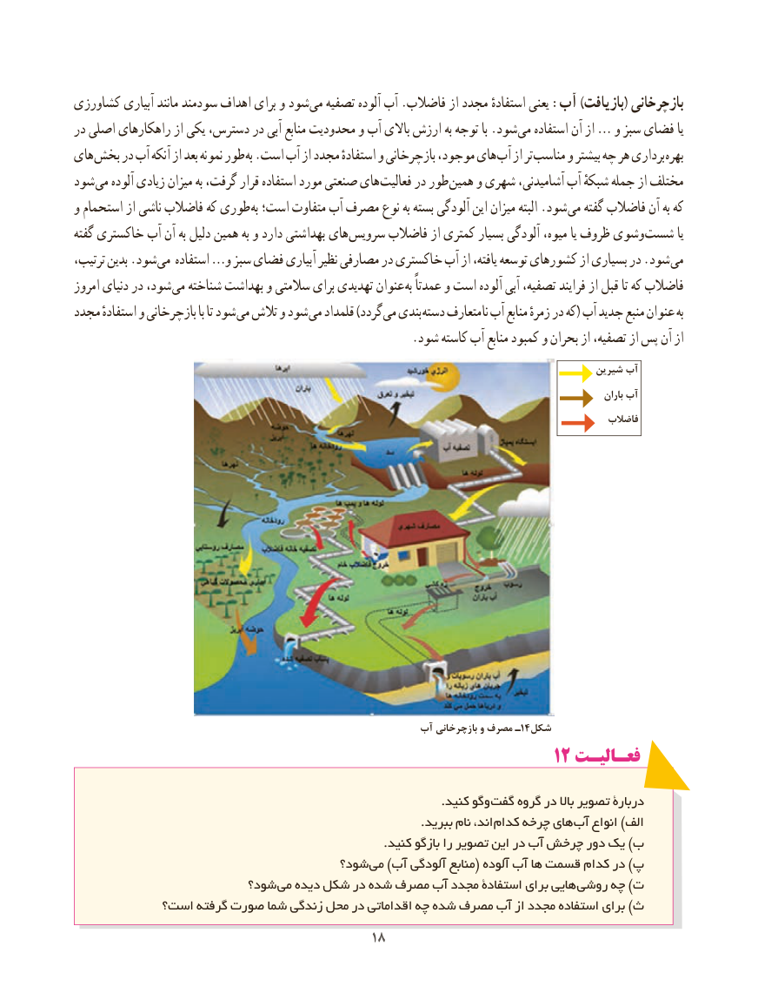

# PDF page 26

کشاورزی آبیاری مانند سودمند اهداف برای و شود می تصفیه آلوده آب .فاضالب از مجدد استفادهٔ یعنی :آب )بازیافت( بازچرخانی
در اصلی راهکارهای از یکی دسترس، در آبی منابع محدودیت و آب باالی ارزش به توجه با .شود می استفاده آن از … و سبز فضای یا
های بخش در آب آنکه از بعد نمونه طور به .است آب از مجدد استفادهٔ و بازچرخانی موجود، های آب از تر مناسب و بیشتر چه هر برداری بهره
شود می آلوده زیادی میزان به گرفت، قرار استفاده مورد صنعتی های فعالیت در طور همین و شهری آشامیدنی، آب شبکهٔ جمله از مختلف
و استحمام از ناشی فاضالب که طوری به است؛ متفاوت آب مصرف نوع به بسته آلودگی این میزان البته .شود می گفته فاضالب آن به که
گفته خاکستری آب آن به دلیل همین به و دارد بهداشتی های سرویس فاضالب از کمتری بسیار آلودگی میوه، یا ظروف وشوی شست یا
ترتیب، بدین .شود می استفاده …و سبز فضای آبیاری نظیر مصارفی در خاکستری آب از یافته، توسعه کشورهای از بسیاری در .شود می
امروز دنیای در شود، می شناخته بهداشت و سالمتی برای تهدیدی عنوان به عمدتاً و است آلوده آبی تصفیه، فرایند از قبل تا که فاضالب
مجدد استفادهٔ و بازچرخانی با تا شود می تالش و شود می قلمداد )گردد می بندی دسته متعارف نا آب منابع زمرهٔ در که( آب جدید منبع عنوان به
                                                        .شود کاسته آب منابع کمبود و بحران از تصفیه، از پس آن از
                                                                                               شیرین آب
                                                                                                                                         باران آب
                                                                                                         فاضالب

                                                      آب بازچرخانی و مصرف ـ14 شکل
                                                       1212 فعـالیـتفعـالیـت

                                                                                             .کنید وگو گفت گروه در باال تصویر دربارۀ
         . ببرید نام اند، کدام چرخه های آب انواع )الف
                                                                               .کنید بازگو را تصویر این در آب چرخش دور یک )ب
                                     شود؟ می )آب آلودگی منابع( آلوده آب ها قسمت کدام در )پ
                        شود؟ می دیده شکل در شده مصرف آب مجدد استفادۀ برای هایی روشی چه )ت
           است؟ گرفته صورت شما زندگی محل در اقداماتی چه شده مصرف آب از مجدد استفاده برای )ث
                                          1818

