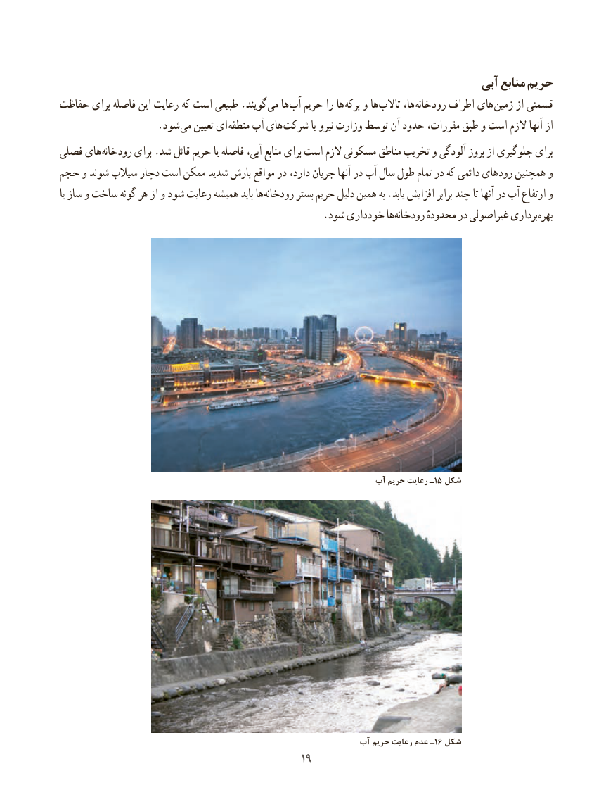

# PDF page 27

آبی منابع حریم
حفاظت برای فاصله این رعایت كه است طبیعی .گویند می ها  آب حریم را ها برکه و ها تاالب ها،  رودخانه اطراف های زمین از قسمتی
        . شود می تعیین ای منطقه آب های شرکت یا نیرو وزارت توسط آن حدود مقررات، طبق و است الزم آنها از
فصلی های رودخانه برای .شد قائل حریم یا فاصله آبی، منابع برای است الزم مسکونی مناطق تخریب و آلودگی بروز از جلوگیری برای
حجم و شوند سیالب دچار است ممکن شدید بارش مواقع در دارد، جریان آنها در آب سال طول تمام در که دائمی های رود همچنین و
یا ساز و ساخت گونه هر از و شود رعایت همیشه باید ها رودخانه بستر حریم دلیل همین به .یابد افزایش برابر چند تا آنها در آب ارتفاع و
       . شود خودداری ها رودخانه محدودهٔ در غیراصولی برداری بهره

                                                             آب حریم رعایت ١ـ5 شکل

                                                          آب حریم رعایت عدم ـ 16 شکل
                                                                                            1919

