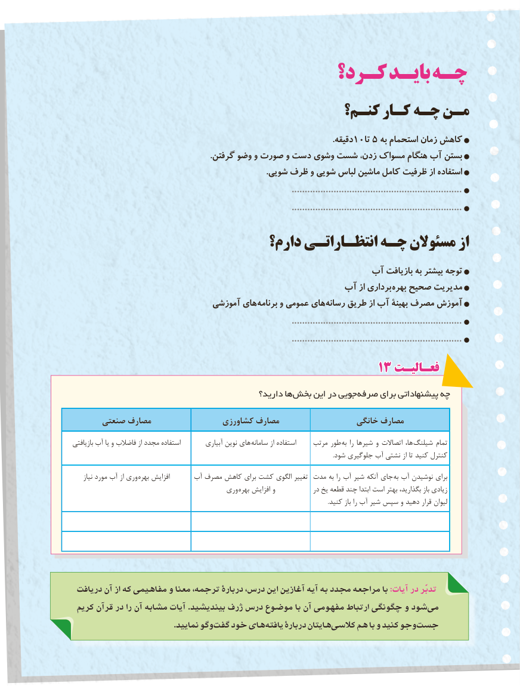

# PDF page 28

كـرد؟ بایـد چـه
                                      کنـم؟ کـار چـه مـن
                        .10دقیقه    تا 5 به استحمام زمان کاهش
                                                                    .گرفتن وضو و صورت و دست وشوی شست زدن، مسواك هنگام آب بستن
                                                                                                .شویی ظرف و شویی لباس ماشین کامل ظرفیت از استفاده
                                                                                    .................................................................
                                                                                    .................................................................
                              دارم؟ انتظـاراتـی چـه مسئوالن از
                                                 آب بازیافت به بیشتر توجه
                                            آب از برداری بهره صحیح مدیریت
                              آموزشی های برنامه و عمومی های رسانه طریق از آب بهینۀ مصرف آموزش
                                                                                    .................................................................
                                                                                    .................................................................
                                              1313 فعـالیـتفعـالیـت

                                               دارید؟ ها بخش این در جویی صرفه برای پیشنهاداتی چه

      صنعتی مصارف                کشاورزی مصارف                  خانگی مصارف

بازیافتی آب یا و فاضالب از مجدد استفاده         آبیاری نوین های سامانه از استفاده     مرتب طور به را شیرها و اتصاالت ها،  شیلنگ تمام
                                                                                                                                                                                  .شود جلوگیری آب نشتی از تا کنید کنترل

     نیاز مورد آب از وری بهره افزایش      آب مصرف کاهش برای کشت الگوی تغییر مدت به را آب شیر آنکه جای  به آب نوشیدن برای
                                        وری بهره افزایش و            در یخ قطعه چند ابتدا است بهتر بگذارید، باز زیادی
                                                                                                                                                                               .کنید باز را آب شیر سپس و دهید قرار لیوان

 دريافت آن از كه مفاهيمي و معنا ترجمه، دربارۀ درس، اين آغازين آيه به مجدد مراجعه با :آیات در تدبّر
 كريم قرآن در را آن مشابه آيات .بينديشيد ژرف درس موضوع با آن مفهومی ارتباط چگونگی و شود می
                                             .نماييد وگو گفت خود های يافته دربارۀ هايتان  كالسی هم با و كنيد وجو جست
                                 2020

