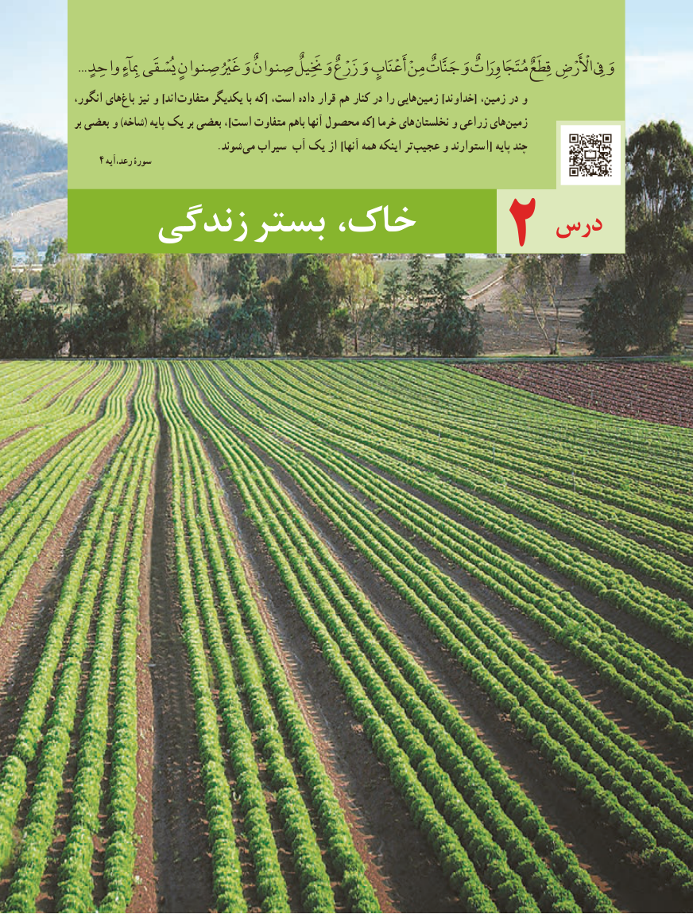

# PDF page 29

... واحِدٍوَمِبِٓاءٍ یُسْقَی صِنوانٍ غَرْیُْ وَ صِنوانٌ خَنَِيلٌ وَ رْعٌ زَ وَ أَعْنَابٍ مِنْ جَنَّاتٌ وَ مُتَاَجَوِرَاتٌ قِطَعٌ اأْلَْرْضِ یِفِ
انگور، های غ با نیز و ]اند متفاوت یکدیگر با که[ است، داده قرار هم کنار در را هایی زمین ]خداوند[ زمین، در و
بر بعضی و )شاخه( پایه یک بر بعضی ،]است متفاوت باهم آنها محصول که[ خرما های نخلستان و زراعی های زمین
          . شوند می سیراب آب یک از ]آنها همه اینکه تر عجیب و استوارند[ پایه چند
    4 رعد،آیه سورۀ

                              درس    زندگی بستر خاک،              2

                                             2121

