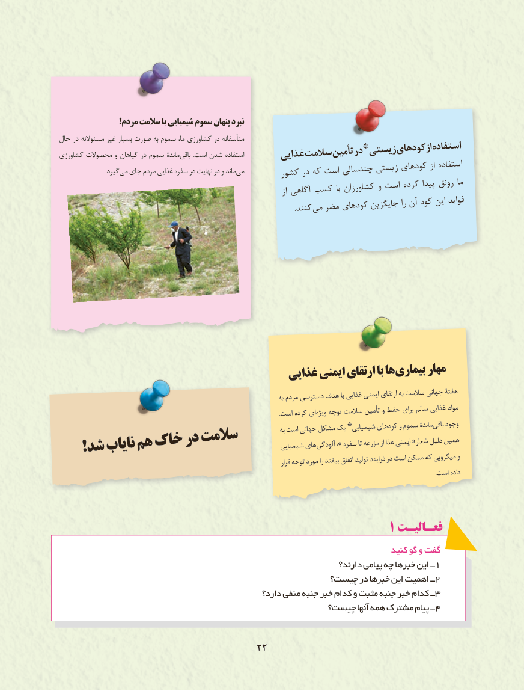

# PDF page 30

!مردم سالمت با شیمیایی سموم پنهان نبرد
حال    در مسئوالنه               غیر                     بسیار                  صورت                                    به سموم                                                      ما،                                     کشاورزی                                                   در متأسفانه                                         *                                                      زیستیکودهایازاستفادهکشاورزی       محصوالت                   و                    گیاهان                           در سموم                                         ماندۀ                                                        باقی                                                                                           .است شدن                                                            استفاده       غذاییسالمتتأمیندر
      . گیردمی جای مردم غذایی سفره در نهایت در و ماند می        کشور در که است چندسالی زیستی کودهای از استفاده
                                                                            از آگاهی کسب با کشاورزان و است کرده پیدا رونق ما
                      . کنندمی مضر کودهای جایگزین را آن کود این فواید

                                      غذایی ایمنی ارتقای با ها بیماری مهار
                                                                             به مردم دسترسی هدف با غذایی ایمنی ارتقای به سالمت جهانی هفتۀ
                                                                                                                  .است کرده ای ویژه توجه سالمت تأمین و حفظ برای سالم غذایی مواد
                                                         *                                                                                     شیمیایی کودهای و سموم ماندۀ باقی وجود                                                                              به است جهانی مشکل یک
                                                                                              همین                                                                                                               دلیل                                                                                    «شعار                                                                                                         ایمنی                                                                                                                                                  از غذا                                                                                                                                      تا مزرعه                                                                                 سفره                                                                                                                         ،»                                                                                                  آلودگی                                                               های                  سالمت            شیمیایی   !شدنایابهمخاکدر                                                                                                                       و                                                                                                                  میکروبی                                                                                                 که                                                                                   ممکن                                                                                                    در است                                                                                                                    فرایند                                                                                                          تولید                                                                                                        اتفاق                                                                                                                      را بیفتد                                                                              مورد                                                                                          قرار توجه
                                                                                                                                                                                                   .است داده

                                                               1 فعـالیـت
                                                                               کنید گو و گفت
                                                                        دارند؟ پیامی چه خبرها این ــ1
                                                چیست؟ در خبرها این اهمیت ــ2
                                                    دارد؟ منفی جنبه خبر کدام و مثبت جنبه خبر کدام ــ3
                                                چیست؟ آنها همه مشترک پیام ــ4

                                      2222

