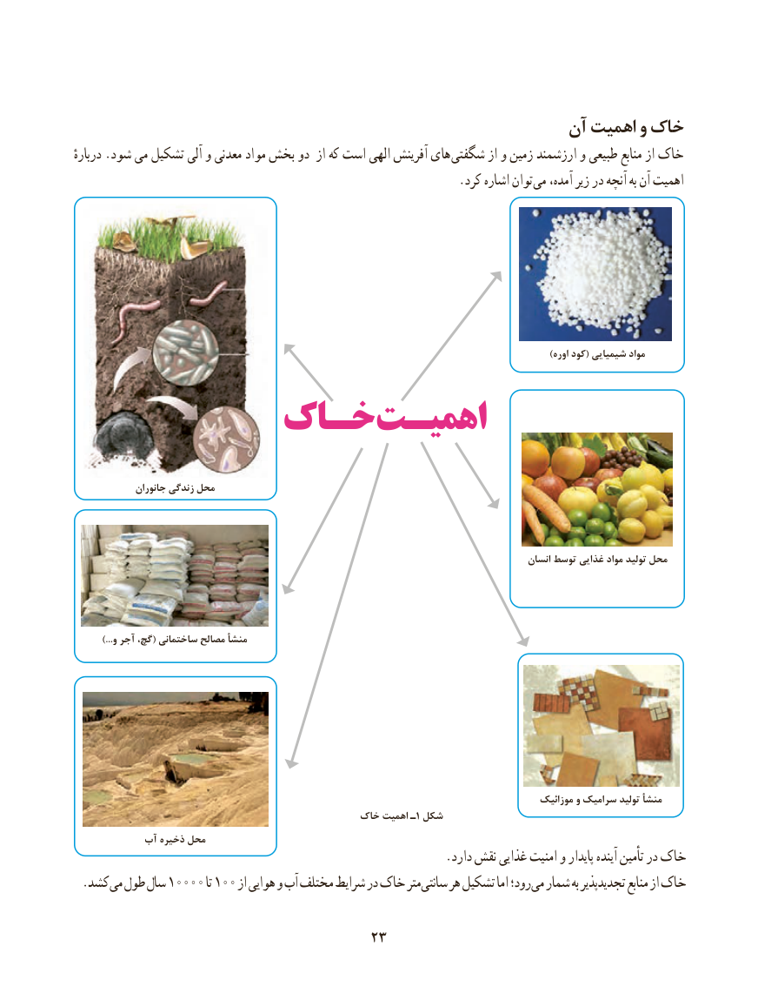

# PDF page 31

آن اهمیت و خاک
دربارهٔ .شود می تشکیل آلی و معدنی مواد بخش دو از که است الهی آفرینش های شگفتی از و زمین ارزشمند و طبیعی منابع از خاک
                                                               .کرد اشاره توان می آمده، زیر در آنچه به آن اهمیت

                                                                                                                             )اوره کود( شیمیایی مواد
         خـاکخـاکاهمیـتاهمیـت

              جانوران زندگی محل

                                                                                                   انسان توسط غذایی مواد تولید محل

          ...)و آجر گچ،( ساختمانی مصالح منشأ

                                                                                                 موزائیک و سرامیک تولید منشأ
                                            خاک اهمیت ـ1 شکل
           آب ذخیره محل
                                                             .دارد نقش غذایی امنیت و پایدار آینده تأمین در خاک
 . کشدمی طول سال 10000 تا 100 از هوایی و آب مختلف شرایط در خاک متر سانتی هر تشکیل اما رود؛ می شمار به تجدیدپذیر منابع از خاک

                                    2323

