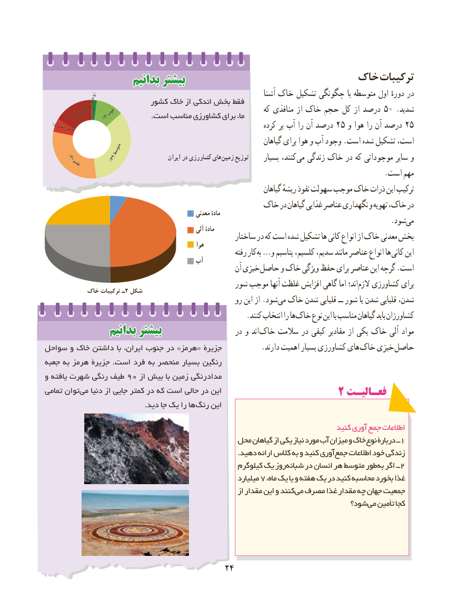

# PDF page 32

بدانیمبدانیم بیشتربیشتر                         خاک ترکیبات
     ۲%                                                                          آشنا خاک تشکیل چگونگی با متوسطه اول دورهٔ در               خوب            کشور خاک از اندکی بخش فقط
                 ناپايدارخيلي خوب                                             که منافذی از خاک حجم کل از درصد 50 .شدید        %17      %12                 .است مناسب کشاورزی برای ما،
  %5فقير       خيلي                                                            کرده پر آب را آن درصد 25 و هوا را آن درصد 25
                                                                        گیاهان برای هوا و آب وجود .است شده تشکیل است،                        متوسط
       %30                  %34                    ایران در کشاورزی های زمین توزیع     بسیار کنند، می زندگی خاک در که موجوداتی سایر و         فقير
                                                                                            .است مهم
                                                                          گیاهان ریشهٔ نفوذ سهولت موجب خاک ذرات این ترکیب
                                          خاک در گیاهان غذایی عناصر نگهداری و تهویه خاک، در                                                      معدنی مادۀ
                                                                                              .شود می                                                         آلی مادۀ
                                                       ساختار در که است شده تشکیل ها کانی انواع از خاک معدنی بخش                                                        هوا
                                                                 رفته کار به …و پتاسیم کلسیم، سدیم، مانند عناصر انواع ها کانی این                                        آب
                                                           آن خیزی حاصل و خاک ویژگی حفظ برای عناصر این گرچه .است
                                             شور موجب آنها غلظت افزایش گاهی اما اند؛ الزم کشاورزی برای           خاک ترکیبات ـ2 شکل
                                                      رو این از .شود می خاک شدن قلیایی ــ شور یا شدن قلیایی شدن،
        . کنند انتخاب را هاخاک نوع این با مناسب گیاهان باید کشاورزان
               بدانیمبدانیم بیشتربیشتر                     در و اند خاک سالمت در کیفی مقادیر از یکی خاک آلی مواد
سواحل و خاک داشتن با ایران، جنوب در »هرمز« جزیرۀ . دارند اهمیت بسیار کشاورزی های خاک خیزی حاصل
جعبه به هرمز جزیرۀ .است فرد به منحصر بسیار رنگین
و یافته شهرت رنگی طیف 90 از بیش با زمین رنگی مداد
تمامی توان می دنیا از جایی کمتر در که است حالی در این                                                 2 فعـالیـتفعـالیـت
    . دید جا یک را ها رنگ این

                                                                                کنید آوری جمع اطالعات
                                          محل گیاهان از یکی نیاز مورد آب میزان و خاک نوع دربارۀ ــ1
                                                                                 .دهید ارائه کالس به و کنید آوری جمع اطالعات خود زندگی
                                                      کیلوگرم یک روز شبانه در انسان هر متوسط طور به اگر ــ 2
                                                              میلیارد 7 ،غذاماه یک یا و هفته یک در کنید محاسبه بخورد
                                                                 از مقدار این و کنند می مصرف غذا مقدار چه جهان جمعیت
                                                                        شود؟ می تأمین کجا

                                      2424

