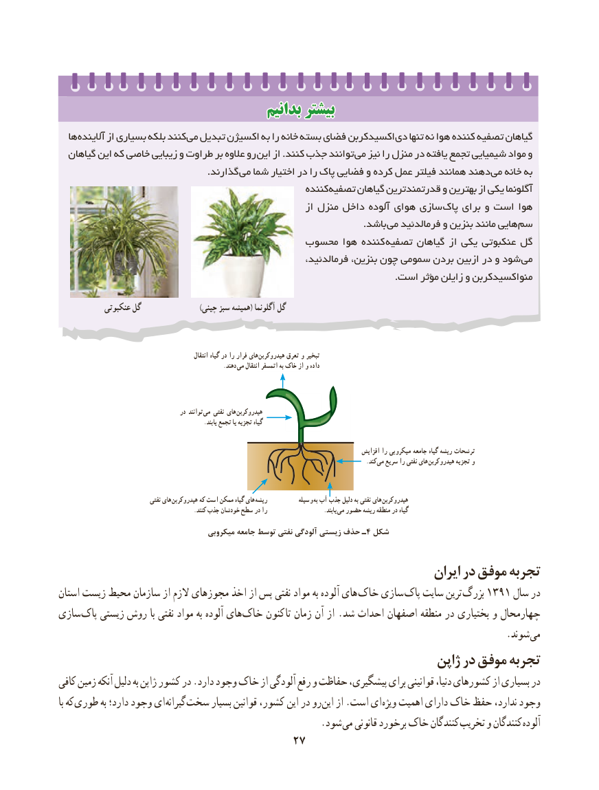

# PDF page 35

بدانیمبدانیم بیشتربیشتر
  ها آالینده از بسیاری بلکه کنند می تبدیل اکسیژن به را خانه بسته فضای اکسیدکربن دی تنها نه هوا کننده تصفیه گیاهان
  گیاهان این که خاصی زیبایی و طراوت بر عالوه رو این از .کنند جذب توانند می نیز را منزل در یافته تجمع شیمیایی مواد و
                                                .گذارند می شما اختیار در را پاک فضایی و کرده عمل فیلتر همانند دهند می خانه به
                                                     کننده تصفیه گیاهان قدرتمندترین و بهترین از یکی آگلونما
                                                              از منزل داخل آلوده هوای سازی  پاک برای و است هوا
                                                                                                  .باشد می فرمالدئید و بنزین مانند هایی سم
                                     محسوب هوا کننده  تصفیه گیاهان از یکی عنکبوتی گل
                                                         فرمالدئید، بنزین، چون سمومی بردن ازبین در و شود می
                                                                                                            .است مؤثر زایلن و منواکسیدکربن

            عنکبوتی گل                         )چینی سبز همیشه( آگلونما گل

                                                         انتقال گیاه در را فرار های هیدروکربن تعرق و تبخیر
                       . دهند می انتقال اتمسفر به خاک از و داده

                                          در توانند می نفتی های هیدروکربن
                                                     .یابند تجمع یا تجزیه گیاه

                                                                                                      افزایش را میکروبی جامعه گیاه ریشه ترشحات
                                                    . کند می سریع را نفتی های هیدروکربن تجزیه و

                                  نفتی های هیدروکربن که است ممکن گیاه های ریشه           وسیله به آب جذب دلیل به نفتی های  هیدروکربن
                                                 .کنند جذب خودشان سطح در را        . یابند می حضور ریشه منطقه در گیاه
                                       میکروبی جامعه توسط نفتی آلودگی زیستی حذف ـ4 شکل

                                                                      ایران در موفق تجربه
استان زیست محیط سازمان از الزم مجوزهای اخذ از پس نفتی مواد به آلوده های  خاک سازی پاک سایت ترین بزرگ 1391 سال در
سازی پاک زیستی روش با نفتی مواد به آلوده های خاک کنون  تا زمان آن از .شد احداث اصفهان منطقه در بختیاری و چهارمحال
                                   . شوند می
                                                               ژاپن در موفق تجربه
کافی زمین آنکه دلیل به ژاپن کشور در .دارد وجود خاک از آلودگی رفع و حفاظت پیشگیری، برای قوانینی دنیا، کشورهای از بسیاری در
با که طوری به دارد؛ وجود ای گیرانه سخت بسیار قوانین کشور، این در رو این از .است ای ویژه اهمیت دارای خاک حفظ ندارد، وجود
                      . شود می قانونی برخورد خاک کنندگان تخریب و کنندگان آلوده
                                     2727

