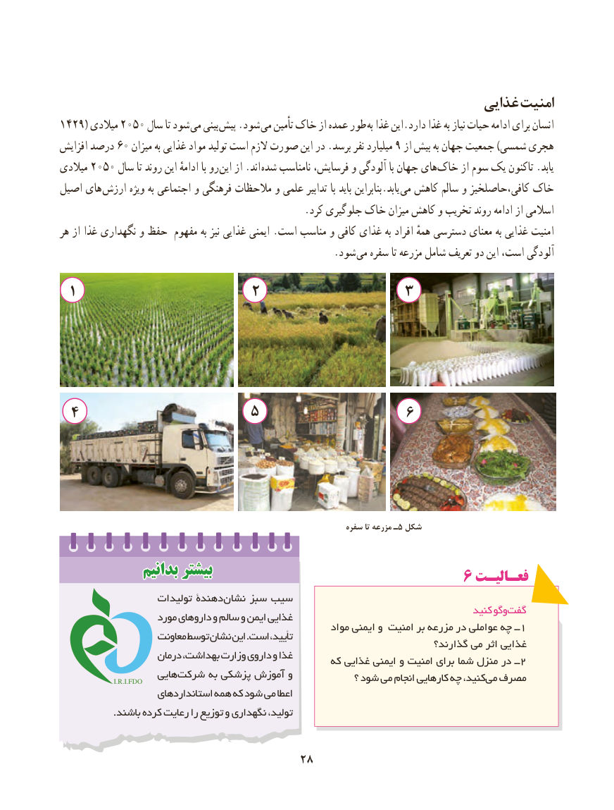

# PDF page 36

غذایی امنیت
1429( میالدی 2050 سال تا شود می بینی  پیش .شود می تأمین خاک از عمده طور به غذا این.دارد غذا به نیاز حیات ادامه برای انسان
افزایش درصد 60 میزان به غذایی مواد تولید است الزم صورت این در .برسد نفر میلیارد 9 از بیش به جهان جمعیت )شمسی هجری
میالدی 2050 سال تا روند این ادامهٔ با رو  این از .اند شده نامناسب ‌،هایفرسایش و آلودگی با جهان       ‌خاک از سوم یک تاکنون .یابد
اصیل های  ارزش ویژه به اجتماعی و فرهنگی مالحظات و علمی تدابیر با باید بنابراین.یابد می کاهش سالم و کافی،حاصلخیز خاک
                                                  .کرد جلوگیری خاک میزان کاهش و تخریب روند ادامه از اسالمی
هر از غذا نگهداری و حفظ مفهوم به نیز غذایی ایمنی .است مناسب و کافی غذای به افراد همهٔ دسترسی معنای به غذایی امنیت
                      . شود می سفره تا مزرعه شامل تعریف دو این است، آلودگی
  ۱                     2               3

 ۴                   ۵                  ۶

                                                                   سفره تا مزرعه ـ5 شکل

              بدانیمبدانیم بیشتربیشتر                                              ۶ فعـالیـتفعـالیـت
                    تولیدات دهندۀ نشان سبز سیب
                                                                                    کنید وگو گفت                    مورد داروهای و سالم و ایمن غذایی
                                                          مواد ایمنی و امنیت بر مزرعه در عواملی چه ــ1                    معاونت توسط نشان این .است تأیید،                                                                            گذارند؟ می اثر غذایی
                    درمان بهداشت، وزارت داروی و غذا                                                   که غذایی ایمنی و امنیت برای شما منزل در ــ2
                 I.R.I.FDO   هایی شرکت به پزشکی آموزش و             ؟ شود می انجام کارهایی چه کنید، می مصرف
                     استانداردهای همه که شود می اعطا
                 .باشند کرده رعایت را توزیع و نگهداری تولید،

                                    2828

