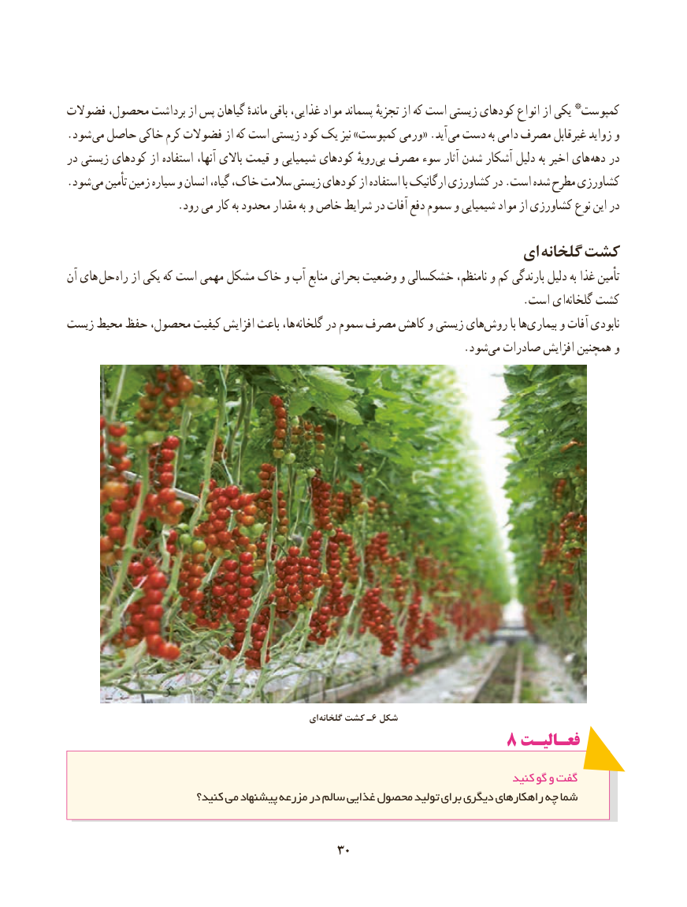

# PDF page 38

فضوالت محصول، برداشت از پس گیاهان ماندهٔ باقی غذایی، مواد پسماند تجزیهٔ از که است زیستی کودهای انواع از یکی * کمپوست
. شود می حاصل خاکی کرم فضوالت از که است زیستی کود یک نیز »کمپوست ورمی« .آید  می دست به دامی مصرف غیرقابل زواید و
در زیستی کودهای از استفاده آنها، باالی قیمت و شیمیایی کودهای رویهٔ بی مصرف سوء آثار شدن آشکار دلیل به اخیر های دهه در
. شود می تأمین زمین سیاره و انسان گیاه، خاک، سالمت زیستی کودهای از استفاده با ارگانیک کشاورزی در .است شده مطرح کشاورزی
                    .رود می کار به محدود مقدار به و خاص شرایط در آفات دفع سموم و شیمیایی مواد از کشاورزی نوع این در
                                                         ای گلخانه کشت
آن های حل راه از یکی که است مهمی مشکل خاک و آب منابع بحرانی وضعیت و خشکسالی نامنظم، و کم بارندگی دلیل به غذا تأمین
                    .‌است ای گلخانه کشت
زیست محیط حفظ محصول، کیفیت افزایش باعث ها، گلخانه در سموم مصرف کاهش و زیستی های‌روش با هابیماری‌     و آفات نابودی
                             .‌شود می صادرات افزایش همچنین و

                                                     ای گلخانه کشت ـ6 شکل
                                           ۸ فعـالیـتفعـالیـت

                                                                                 کنید گو و گفت
                        کنید؟ می پیشنهاد مزرعه در سالم غذایی محصول تولید برای دیگری راهکارهای چه شما

                                         3030

