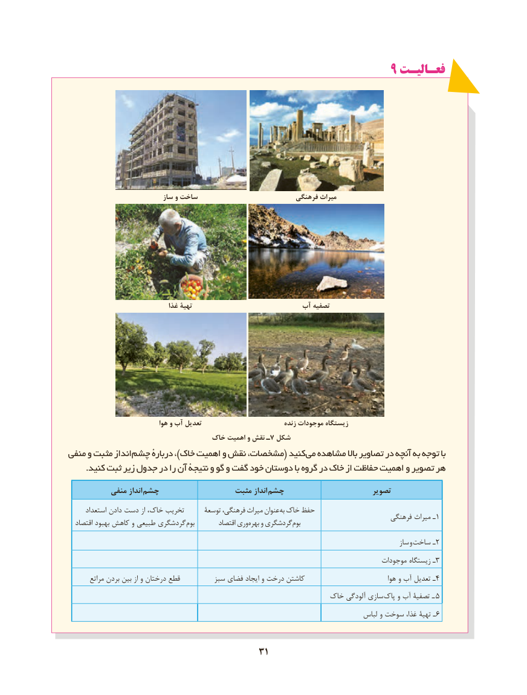

# PDF page 39

9 فعـالیـتفعـالیـت

                            ساز و ساخت                          فرهنگی میراث

                               غذا تهیۀ                         آب تصفیه

                               هوا و آب تعدیل                           زنده موجودات زیستگاه
                                خاک اهمیت و نقش ـ7 شکل
منفی و مثبت انداز چشم دربارهٔ ،)خاک اهمیت و نقش مشخصات،( کنید می مشاهده باال تصاویر در آنچه به توجه با
      .کنید ثبت زیر جدول در را آن نتیجهٔ و گو و گفت خود دوستان با گروه در خاک از حفاظت اهمیت و تصویر هر
           منفی انداز چشم                  مثبت انداز  چشم                       تصویر
      استعداد دادن دست از خاک، تخریب      توسعۀ فرهنگی، میراث عنوان به خاک حفظ                                                                                          فرهنگی میراث ـ1  اقتصاد بهبود کاهش و طبیعی گردشگری بوم        اقتصاد وری بهره و گردشگری بوم
                                                                                                        ساز و ساخت ـ2
                                                                                       موجودات زیستگاه ـ3
       مراتع بردن بین از و درختان قطع         سبز فضای ایجاد و درخت کاشتن                              هوا و آب تعدیل ـ4
                                                        خاک آلودگی سازی  پاک و آب تصفیۀ ـ  5
                                                                                   لباس و سوخت غذا، تهیۀ ـ 6

                                       3131

