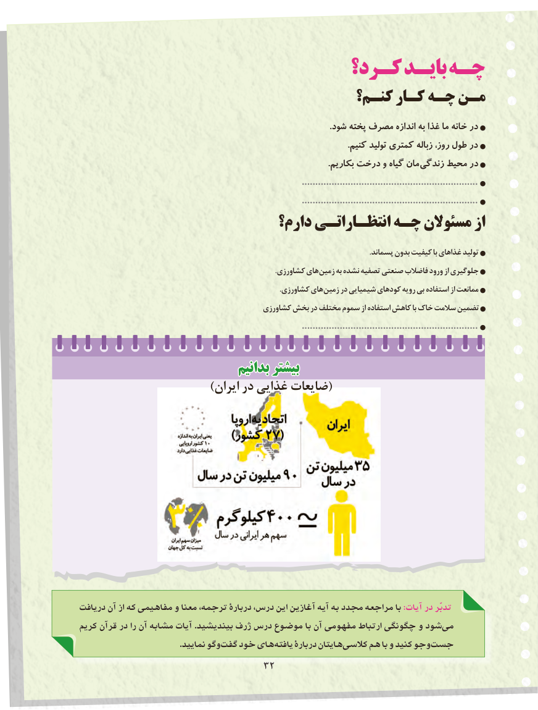

# PDF page 40

كـرد؟ بایـد چـه
                                     کنـم؟ کـار چـه مـن
                                                                                                                       .شود پخته مصرف اندازه به غذا ما خانه در
                                                                                                                                .کنیم تولید کمتری زباله روز، طول در
                                                                                                                       .بکاریم درخت و گیاه مان زندگی محیط در
                                                                                  .................................................................
                                                                                  .................................................................
                             دارم؟ انتظـاراتـی چـه مسئوالن از
                                                                                                                                                            .پسماند بدون کیفیت با غذاهای تولید
                                                                                                         .کشاورزی های زمین به نشده تصفیه صنعتی فاضالب ورود از جلوگیری
                                                                                                            .کشاورزی های زمین در شیمیایی کودهای رویه بی استفاده از ممانعت
                                             کشاورزی بخش در مختلف سموم از استفاده کاهش با خاک سالمت تضمین
                                                                                  .................................................................

                               بدانیمبدانیم بیشتربیشتر
                           )ایران در غذایی ضایعات(

دريافت آن از كه مفاهيمي و معنا ترجمه، دربارۀ درس، اين آغازين آيه به مجدد مراجعه با :آیات در تدبّر
كريم قرآن در را آن مشابه آيات .بينديشيد ژرف درس موضوع با آن مفهومی ارتباط چگونگی و شود می
                                           .نماييد وگو گفت خود های يافته دربارۀ هايتان كالسی  هم با و كنيد وجو جست
                                3232

