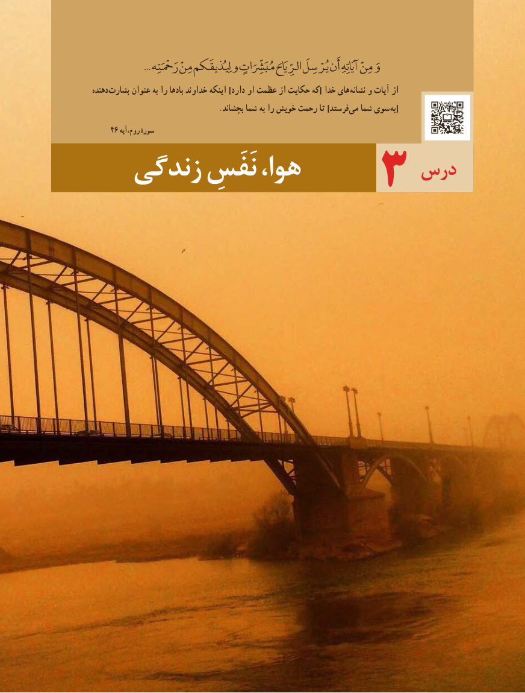

# PDF page 41

... رَمْحَْتِه مِنْ یِلُِذیقَکم و مُبَرِّشَِّاتٍ الرِّیَاحَ یُرْسِلَ أَن آیَاتِهِ مِنْ وَ
دهنده بشارت عنوان به را بادها خداوند اینکه ]دارد او عظمت از حکایت که[ خدا های نشانه و آیات از
  . بچشاند شما به را خویش رحمت تا ]فرستد می شما سوی [به
    46 روم،آیه سورهٴ
                           درس   زندگی نَفَسِ هوا،          3

                           3333

