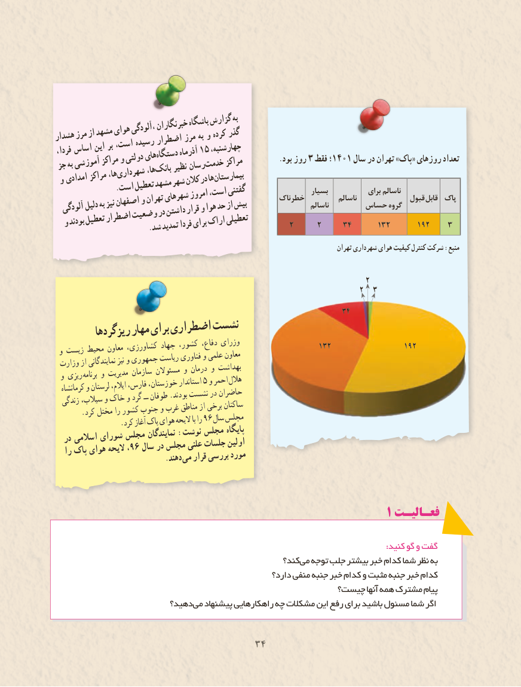

# PDF page 42

باشگاهگزارشبه                           خبرنگارانهشدارمرزازمشهدهوای،آلودگی                              مرز به و کرده گذر                      اضطرار                   رسیده              بر است،          این    اساس                                           ،چهارشنبه                         15فردا،                                    آذرماه                          دستگاه‌                    های          ودولتی            مراکز                                             مراکز          .بود روز 3 فقط ؛ 1401 سال در تهران »پاک« روزهای تعداد    آموزشی                             خدمت‌ جزبه                              رسان                              نظیر                          ها،بانک‌              شهرداری‌               ها،         مراکز                                             بیمارستان                                       ها   امدادی                                در و                        شهرکالن                      مشهد           استتعطیل .‌                                                                           بسیار                                                                                                برای ناسالم                                            گفتنی                                است،                                  امروز                                                     خطرناک                                                                                           ناسالم                                                                                               قبول قابل  پاک                         شهرهای              وتهران              اصفهان                                                                                  ناسالم                                                         حساس                                                                                                 گروه            بهنیز                                    بیش        دلیل                                حداز                       وهوا  آلودگی                                   قرار                          داشتن                       در              وضعیت           اضطرار وبودندتعطیل                                                      2     2     34      132      192    3                 .شدتمدیدفردابرایاراکتعطیلی
                                                                                              تهران شهرداری هوای کیفیت کنترل شرکت :منبع

                                                                          2
                                                                         2  3
                                                                     34
         گردها ریزمهاربرایاضطرارینشست
                                                               132                 192 و زیست محیط معاون کشاورزی، جهاد کشور، دفاع، وزرای وزارت از نمایندگانی نیز و جمهوری ریاست فناوری و علمی معاون و ریزی برنامه و مدیریت سازمان مسئوالن و درمان و بهداشت  کرمانشاه و لرستان ایالم، فارس، خوزستان، استاندار 5 و احمر هالل  زندگی سیالب، و خاک و گرد ــ طوفان .بودند نشست در حاضران      .کرد مختل را کشور جنوب و غرب مناطق از برخی ساکنان  .96کرد آغاز پاک هوای الیحه با را  سال مجلس
  در اسالمی شورای مجلس نمایندگان :نوشت مجلس پایگاه   را پاک هوای الیحه ،96 سال در مجلس علنی جلسات اولین           . دهندمی قرار بررسی مورد

                                                               1 فعـالیـت

                                                                                                                          :کنید گو و گفت
                                                       کند؟ می توجه جلب بیشتر خبر کدام شما نظر به
                                                        دارد؟ منفی جنبه خبر کدام و مثبت جنبه خبر کدام
                                                   چیست؟ آنها همه مشترک پیام
                         دهید؟ می پیشنهاد راهکارهایی چه مشکالت این رفع برای باشید مسئول شما اگر

                                   3434

