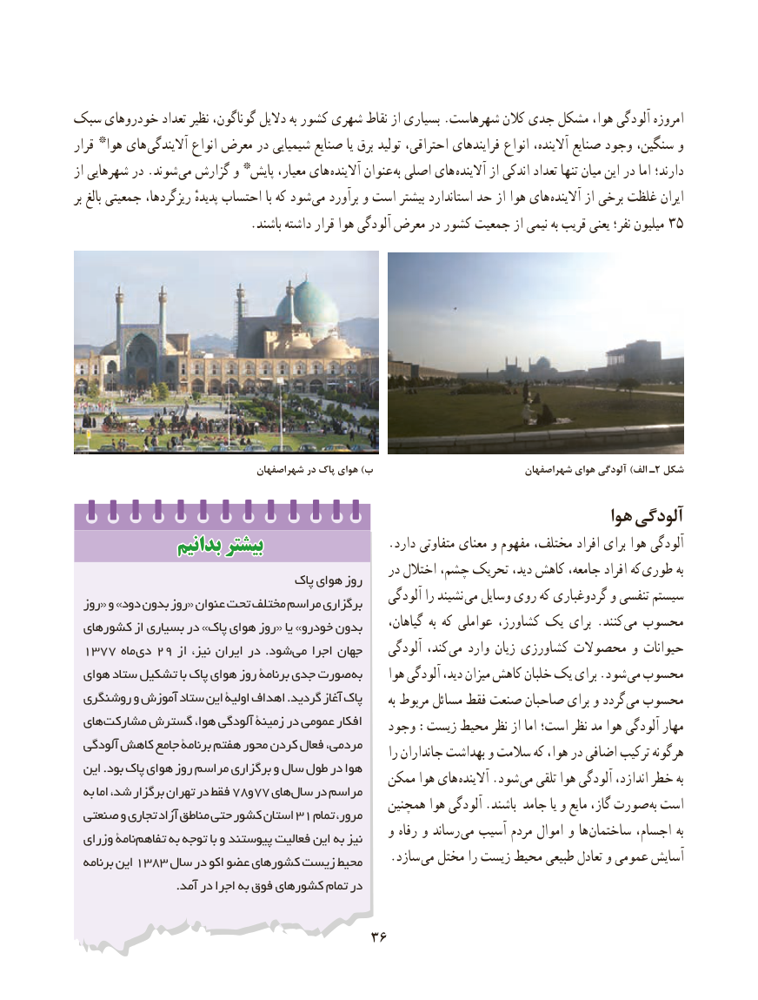

# PDF page 44

سبک خودروهای تعداد نظیر گوناگون، دالیل به کشور شهری نقاط از بسیاری .شهرهاست کالن جدی مشکل هوا، آلودگی امروزه
قرار * هوا های آالیندگی انواع معرض در شیمیایی صنایع یا برق تولید احتراقی، فرایندهای انواع آالینده، صنایع وجود سنگین، و
از شهرهایی در .شوند می گزارش و * پایش معیار، های  آالینده عنوان به اصلی های آالینده از اندکی تعداد تنها میان این در اما دارند؛
بر بالغ جمعیتی ریزگردها، پدیدهٔ احتساب با که شود  می برآورد و است بیشتر استاندارد حد از هوا های آالینده از برخی غلظت ایران
 . باشند داشته قرار هوا آلودگی معرض در کشور جمعیت از نیمی به قریب یعنی نفر؛ میلیون 35

                                   شهراصفهان در پاك هوای )ب                             شهراصفهان هوای آلودگی )الف ٢ـ شكل
                                                                         هوا آلودگی
              بدانیمبدانیم بیشتربیشتر                     .دارد متفاوتی معنای و مفهوم مختلف، افراد برای هوا آلودگی
                                                     در اختالل چشم، تحریک دید، کاهش جامعه، افراد که طوری به                                   پاک هوای روز
                                                        آلودگی را نشیند می وسایل روی که گردوغباری و تنفسی سیستم  روز« و »دود بدون روز« عنوان تحت مختلف مراسم برگزاری
 کشورهای از بسیاری در »پاک هوای روز« یا »خودرو بدون     گیاهان، به که عواملی کشاورز، یک برای .کنند  می محسوب
 ۱۳۷۷ ماه دی۲۹ از نیز، ایران در .شود می اجرا جهان     آلودگی کند، می وارد زیان کشاورزی محصوالت و حیوانات
 هوای ستاد تشکیل با پاک هوای روز برنامۀ جدی صورت به     هوا آلودگی دید، میزان کاهش خلبان یک برای .شود  می محسوب
 روشنگری و آموزش ستاد این اولیۀ اهداف .گردید آغاز پاک       به مربوط مسائل فقط صنعت صاحبان برای و گردد می محسوب
 های مشارکت گسترش هوا، آلودگی زمینۀ در عمومی افکار    وجود :زیست محیط نظر از اما است؛ نظر مد هوا آلودگی مهار
  آلودگی کاهش جامع برنامۀ هفتم محور کردن فعال مردمی،     را جانداران بهداشت و سالمت که هوا، در اضافی ترکیب هرگونه
  این .بود پاک هوای روز مراسم برگزاری و سال طول در هوا                                              ممکن هوا های آالینده .شود می تلقی هوا آلودگی اندازد، خطر به  به اما شد، برگزار تهران در فقط ۷8و۷7 های سال در مراسم
                                                  همچنین هوا آلودگی .باشند جامد یا و مایع گاز، صورت به است صنعتی و تجاری آزاد مناطق حتی کشور استان 31 تمام مرور،
                                                    و رفاه و رساند می آسیب مردم اموال و ها  ساختمان اجسام، به  وزرای نامۀ تفاهم به توجه با و پیوستند فعالیت این به نیز
  برنامه این ۱۳۸۳ سال در اکو عضو کشورهای زیست محیط  . سازد می مختل را زیست محیط طبیعی تعادل و عمومی آسایش
                          .آمد در اجرا به فوق کشورهای تمام در

                                    3636

