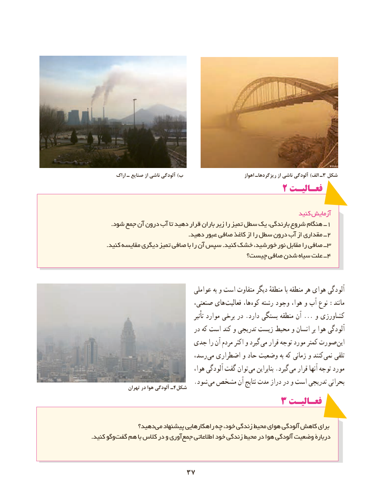

# PDF page 45

اراک ـ صنایع از ناشی آلودگی )ب                               اهواز ریزگردهاـ از ناشی آلودگی )الف ٣ـ شكل
                                       ۲ فعـالیـت

                                                                    کنید آزمایش
          .شود جمع آن درون آب تا دهید قرار باران زیر را تمیز سطل یک بارندگی، شروع هنگام ــ1
                                                 .دهید عبور صافی کاغذ از را سطل درون آب از مقداری ــ2
        .کنید مقایسه دیگری تمیز صافی با را آن سپس .کنید خشک خورشید، نور مقابل را صافی ــ3
                                      چیست؟ صافی شدن سیاه علت ــ4

                                    عواملی به و است متفاوت دیگر منطقهٔ با منطقه هر هوای آلودگی
                                 صنعتی، های فعالیت ها، کوه رشته وجود هوا، و آب نوع :مانند
                                                     تأثیر موارد برخی در .دارد بستگی منطقه آن ... و کشاورزی
                                  در که است کند و تدریجی زیست محیط و انسان بر هوا آلودگی
                        جدی را آن مردم اکثر و گیرد می قرار توجه مورد کمتر صورت این
                                رسد، می اضطراری و حاد وضعیت به که زمانی و کنند  نمی تلقی
                                       هوا، آلودگی گفت توان  می بنابراین .گیرد می قرار آنها توجه مورد
                                  .شود می مشخص آن نتایج مدت دراز در و است تدریجی بحرانی                تهران در هوا آلودگی ـ 4شکل
                                ۳ فعـالیـتفعـالیـت

              دهید؟ می پیشنهاد راهکارهایی چه خود، زندگی محیط هوای آلودگی کاهش برای
. کنید وگوگفت هم با کالس در و آوری جمع اطالعاتی خود زندگی محیط در هوا آلودگی وضعیت دربارۀ

                      3737

