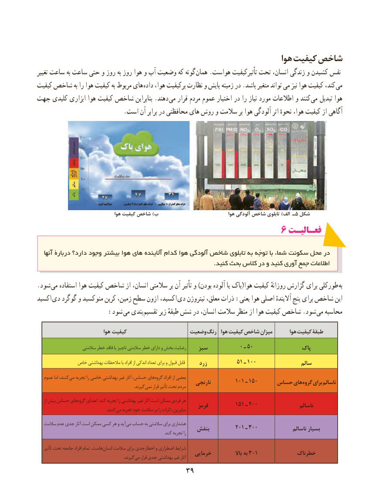

# PDF page 47

هوا کیفیت شاخص
تغییر ساعت به ساعت حتی و روز به روز هوا و آب وضعیت که گونه همان .هواست تأثیرکیفیت تحت انسان، زندگی و کشیدن نفس
کیفیت شاخص به را هوا کیفیت به مربوط های  داده هوا، برکیفیت نظارت و پایش زمینه در .باشد متغیر تواند می نیز هوا کیفیت کند،  می
جهت کلیدی ابزاری هوا کیفیت شاخص بنابراین .دهند می قرار مردم عموم اختیار در را نیاز مورد اطالعات و کنند می تبدیل هوا
                            .است آن برابر در محافظتی های روش و سالمت بر هوا آلودگی اثر نحوهٔ هوا، کیفیت از آگاهی

                                    هوا کیفیت شاخص )ب                                 هوا آلودگی شاخص تابلوی )الف ـ5 شکل
                                             6 فعـالیـتفعـالیـت

   آنها دربارۀ دارد؟ وجود بیشتر هوا های آالینده کدام هوا آلودگی شاخص تابلوی به توجّه با شما، سکونت محل در
                                                                                         .کنید بحث کالس در و کنید آوری جمع اطالعات

.شود می استفاده هوا کیفیت شاخص از انسان، سالمتی بر آن تأثیر و )بودن آلوده یا پاک(هوا کیفیت روزانهٔ گزارش برای طورکلی به
اکسید دی گوگرد و منوکسید کربن زمین، سطح ازون اکسید، دی نیتروژن معلق، ذرات :یعنی هوا اصلی آالیندهٔ پنج برای شاخص این
         : شود می بندی تقسیم زیر طبقهٔ شش در انسان، سالمت منظر از هوا کیفیت شاخص .شود می محاسبه

                            هوا کیفیت                   وضعیت رنگ  هوا کیفیت شاخص میزان       هوا کیفیت طبقۀ
                    سالمتی خطر فاقد یا ناچیز سالمتی خطر دارای و بخش رضایت    سبز           0 ـ 50                پاک
             خاص بهداشتی مالحظات با افراد از اندکی تعداد برای و قبول قابل      زرد          51 ـ 100                 سالم

   عموم اما کنند، می تجربه را خاصی بهداشتی غیر آثار حساس، های گروه افراد از بعضی                                                               نارنجی        101 ـ 150     حساس های گروه برای ناسالم                . گیرندنمی قرار تأثیر تحت مردم

     از بیش حساس های گروه اعضای .کند تجربه را بهداشتی غیر آثار است ممکن فردی هر                                                               قرمز         151 ـ 200                  ناسالم             . کنندمی تجربه خود سالمت بر را اثرات ، سایرین

   سالمت عدم جدی آثار است ممکن کسی هر و آید می حساب به سالمتی برای هشداری                                                  بنفش        201 ـ 300               ناسالم بسیار                                                                                                                                     .کند تجربه را

    تأثیر تحت جامعه افراد تمام .هاست انسان سالمت برای اخطارجدی و اضطراری شرایط
                                                        خرمایی              باال به 301            خطرناک               . گیرندمی قرار جدی بهداشتی غیر آثار
                                    3939

