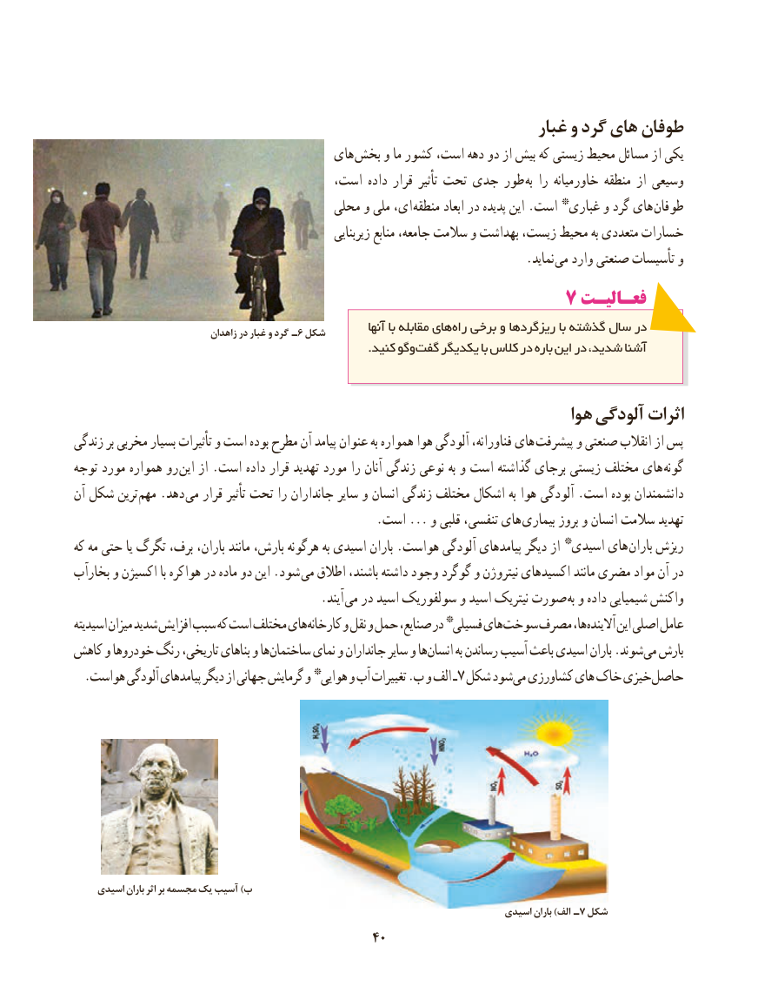

# PDF page 48

غبار و گرد های طوفان
                                       های بخش و ما کشور است، دهه دو از بیش که زیستی محیط مسائل از یکی
                                     است، داده قرار تأثیر تحت جدی طور به را خاورمیانه منطقه از وسیعی
                                        محلی و ملی ای،  منطقه ابعاد در پدیده این .است * غباری و گرد های طوفان
                                                          زیربنایی منابع جامعه، سالمت و بهداشت زیست، محیط به متعددی خسارات
                                                                          .نماید می وارد صنعتی تأسیسات و
                                           7 فعـالیـتفعـالیـت
                               زاهدان در غبار و گرد ـ 6 شکل          آنها با مقابله های راه برخی و ریزگردها با گذشته سال در
            . کنید وگوگفت یکدیگر با کالس در باره این در شدید، آشنا

                                                                    هوا آلودگی اثرات
زندگی بر مخربی بسیار تأثیرات و است بوده مطرح آن پیامد عنوان به همواره هوا آلودگی فناورانه، های پیشرفت و صنعتی انقالب از پس
توجه مورد همواره رو این از .است داده قرار تهدید مورد را آنان زندگی نوعی به و است گذاشته برجای زیستی مختلف های  گونه
آن شکل ترین  مهم .دهد می قرار تأثیر تحت را جانداران سایر و انسان زندگی مختلف اشکال به هوا آلودگی .است بوده دانشمندان
                                                  .است ... و قلبی تنفسی، های  بیماری بروز و انسان سالمت تهدید
که مه حتی یا تگرگ برف، باران، مانند بارش، هرگونه به اسیدی باران .هواست آلودگی پیامدهای دیگر از * اسیدی های باران ریزش
بخارآب و اکسیژن با هواکره در ماده دو این .شود  می اطالق باشند، داشته وجود گوگرد و نیتروژن اکسیدهای مانند مضری مواد آن در
                   . آیند می در اسید سولفوریک و اسید نیتریک صورت به و داده شیمیایی واکنش
اسیدیته میزان شدید افزایش سبب که است مختلف های کارخانه و نقل و حمل صنایع، در *فسیلی های سوخت مصرف ها، آالینده این اصلی عامل
کاهش و خودروها رنگ تاریخی، بناهای و ها ساختمان نمای و جانداران سایر و ها انسان به رساندن  آسیب باعث اسیدی باران .شوند می بارش
.7هواست آلودگی پیامدهای دیگر از جهانی گرمایش و *هوایی و آب تغییرات .ب و الف ـ شکل شود می کشاورزی های خاک خیزی حاصل

    اسیدی باران اثر بر مجسمه یک آسیب )ب
                                                                               اسیدی باران )الف ـ 7 شکل
                                            4040

