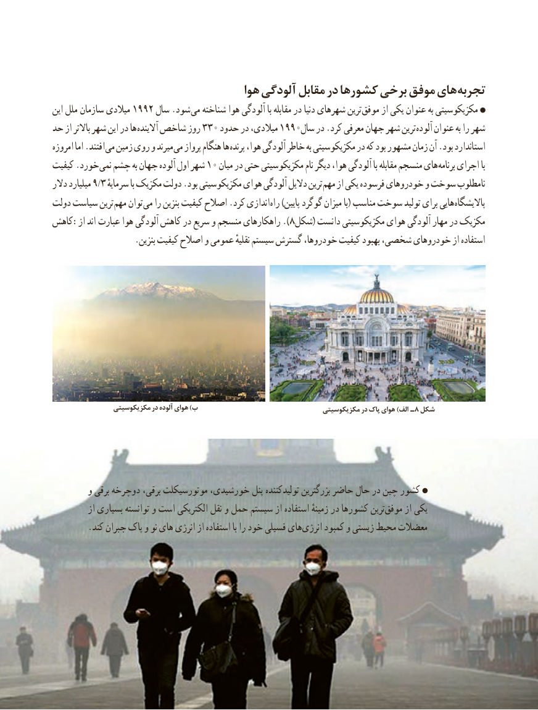

# PDF page 49

هوا آلودگی مقابل در کشورها برخی موفق های تجربه
این ملل  سازمان میالدی 1992 سال .شود می شناخته هوا آلودگی با مقابله در دنیا شهرهای ترین موفق از یکی عنوان به مکزیکوسیتی
حد از باالتر شهر این در ها آالینده شاخص روز 330 حدود در میالدی، 1990سال در .کرد معرفی جهان شهر ترین آلوده عنوان به را شهر
امروزه اما .افتند می زمین روی و میرند می پرواز هنگام ها پرنده هوا، آلودگی خاطر به مکزیکوسیتی در که بود مشهور زمان آن .بود استاندارد
کیفیت .خورد نمی چشم به جهان آلوده اول شهر 10 میان در حتی مکزیکوسیتی نام دیگر هوا، آلودگی با مقابله منسجم های برنامه اجرای با
دالر میلیارد 9/3 سرمایهٔترینبا مکزیک دولت .بود مکزیکوسیتی هوای آلودگی دالیل        مهم از یکی فرسوده خودروهای و سوخت نامطلوب
دولت سیاست ترین مهم توان می را بنزین کیفیت اصالح .کرد اندازی راه )پایین گوگرد میزان با( مناسب سوخت تولید برای هایی پاالیشگاه
کاهش:از اند  عبارت هوا آلودگی کاهش در سریع و منسجم راهکارهای ).8شکل( دانست مکزیکوسیتی هوای آلودگی مهار در مکزیک
                   .بنزین کیفیت اصالح و عمومی نقلیهٔ سیستم گسترش خودروها، کیفیت بهبود شخصی، خودروهای از استفاده

                مکزیکوسیتی در آلوده هوای )ب                                 مکزیکوسیتی در پاک هوای )الف ـ8 شکل

        و برقی دوچرخه برقی، موتورسیکلت خورشیدی، پنل تولیدکننده بزرگترین حاضر حال در چین کشور
          از بسیاری توانسته و است الکتریکی نقل و حمل سیستم از استفاده زمینهٔ در کشورها ترین‌موفق از یکی
 .‌کند جبران پاک و نو یها انرژی از استفاده با را خود فسیلی های ‌انرژی کمبود و ‌زیستی محیط معضالت

                                             4141

