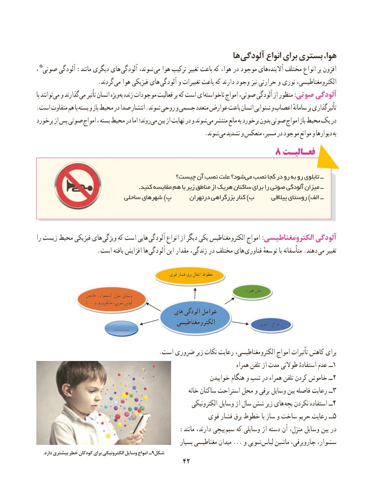

# PDF page 50

ها آلودگی انواع برای بستری هوا،
،* صوتی آلودگی :مانند دیگری های  آلودگی شوند، می هوا ترکیب تغییر باعث که هوا، در موجود های آالینده مختلف انواع بر افزون
       . گردند می هوا فیزیکی های  آلودگی و تغییرات باعث که دارند وجود نیز حرارتی و نوری الکترومغناطیسی،
با توانند می و گذارند می تأثیر انسان ویژه به زنده موجودات فعالیت بر که است ای ناخواسته امواج صوتی، آلودگی از منظور :صوتی آلودگی
.است متفاوت هم با بسته و باز محیط در صدا انتشار .شوند روحی و جسمی متعدد عوارض باعث انسان شنوایی و اعصاب سامانهٔ بر تأثیرگذاری
برخورد از پس صوتی امواج ، بسته محیط در اما روند؛ می بین از نهایت در و شوند می منتشر مانع به برخورد بدون صوتی امواج باز محیط یک در
                     . شوندمی تشدید و منعکس مسیر، در موجود موانع و دیوارها به
                                           8 فعـالیـتفعـالیـت

                                   چیست؟ آن نصب علت شود؟ می نصب کجا در رو به رو تابلوی ــ
                                                     .کنید مقایسه هم با زیر مناطق از هریک ساکنان برای را صوتی آلودگی میزان ــ
                           ساحلی شهرهای )پ      درتهران بزرگراهی کنار )ب      ییالقی روستای )الف ــ

را زیست محیط فیزیکی های  ویژگی که است هایی آلودگی انواع از دیگر یکی الکترومغناطیس امواج :الکترومغناطیسی آلودگی
  . است یافته افزایش ها آلودگی این مقدار زندگی، در مختلف های فناوری توسعهٔ با متأسفانه .دهند  می تغییر

                                                         قوی فشار برق انتقال خطوط

                                                                                                                                 همراه تلفن
                          ماشین سشوار،( منزل وسایل
                           ...) و مایکروویو شویی، لباس
                                               های آلودگی عوامل
                                                   الکترومغناطیسی                          رادیویی امواج
                                                                .............

                                         .است ضروری زیر نکات رعایت الکترومغناطیسی، امواج تأثیرات کاهش برای
                                                                                همراه تلفن از مدت طوالنی استفادهٔ عدم ــ1
                                                              خوابیدن هنگام و شب در همراه تلفن کردن خاموش ــ2
                                                             خانه ساکنان استراحت محل و برقی وسایل بین فاصله رعایت ــ3
                                                            الکترونیکی وسایل از سال شش زیر های بچه نکردن استفاده ــ4
                                                قوی فشار برق خطوط با ساز و ساخت حریم رعایت ــ5
                                      :مانند دارند، پیچی سیم که وسایلی از دسته آن منزل، وسایل بین در
                                                         بسیار مغناطیسی میدان ... و شویی  لباس ماشین جاروبرقی، سشوار،
      .دارد بیشتری خطر کودکان برای الکترونیکی وسایل امواج ـ9شکل
                                      4242

