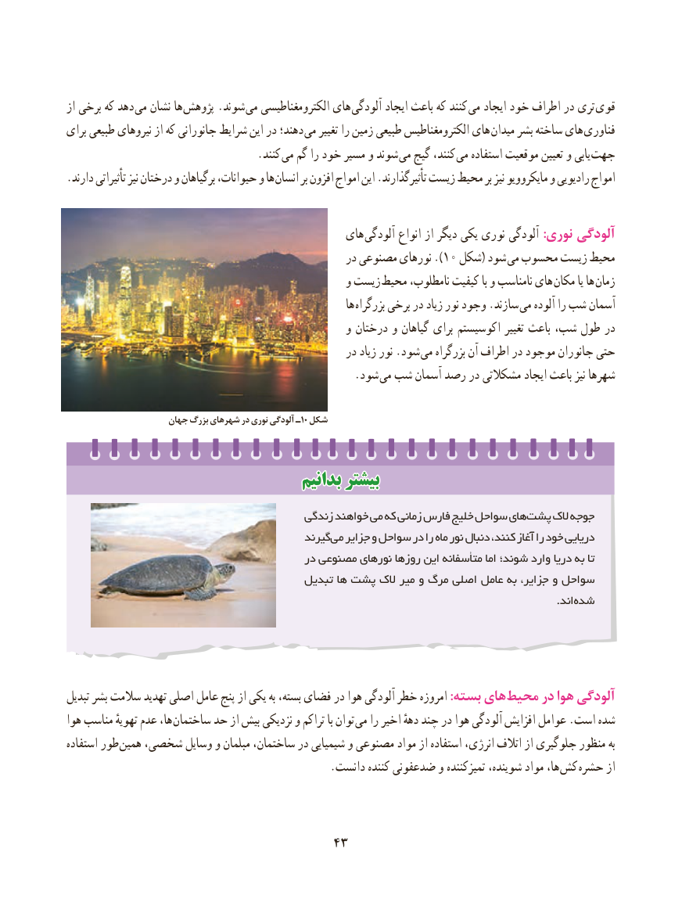

# PDF page 51

از برخی که دهد می نشان ها پژوهش .شوند می الکترومغناطیسی های  آلودگی ایجاد باعث که کنند  می ایجاد خود اطراف در تری  قوی
برای طبیعی نیروهای از که جانورانی شرایط این در دهند؛ می تغییر را زمین طبیعی الکترومغناطیس های میدان بشر ساخته های  فناوری
              . کنند می گم را خود مسیر و شوند می گیج کنند، می استفاده موقعیت تعیین و یابی  جهت
. دارند تأثیراتی نیز درختان و برگیاهان حیوانات، و ها انسان بر افزون امواج این .تأثیرگذارند زیست محیط بر نیز مایکروویو و رادیویی امواج

                                              های آلودگی انواع از دیگر یکی نوری آلودگی :نوری آلودگی
                                                    در مصنوعی نورهای ).10 شکل( شود می محسوب زیست محیط
                                                   و زیست  محیط نامطلوب، کیفیت با و نامناسب های  مکان یا ها زمان
                                                                 ها بزرگراه برخی در زیاد نور وجود .سازند می آلوده را شب آسمان
                                                   و درختان و گیاهان برای اکوسیستم تغییر باعث شب، طول در
                                                    در زیاد نور .شود می بزرگراه آن اطراف در موجود جانوران حتی
                     . شود می شب آسمان رصد در مشکالتی ایجاد باعث نیز شهرها

                     جهان بزرگ شهرهای در نوری آلودگی ـ 10 شکل

                                    بدانیمبدانیم بیشتربیشتر

                                         زندگی خواهند می که زمانی فارس خلیج سواحل های پشت الک جوجه
                                             گیرند می جزایر و سواحل در را ماه نور دنبال کنند، آغاز را خود دریایی
                                          در مصنوعی نورهای روزها این متأسفانه اما شوند؛ وارد دریا به تا
                                         تبدیل ها پشت الک میر و مرگ اصلی عامل به جزایر، و سواحل
                                                 . اندشده

تبدیل بشر سالمت تهدید اصلی عامل پنج از یکی به بسته، فضای در هوا آلودگی خطر امروزه :بسته های محیط در هوا آلودگی
هوا مناسب تهویهٔ عدم ها، ساختمان حد از بیش نزدیکی و تراکم با توان می را اخیر دههٔ چند در هوا آلودگی افزایش عوامل .است شده
استفاده طور  همین شخصی، وسایل و مبلمان ساختمان، در شیمیایی و مصنوعی مواد از استفاده انرژی، اتالف از جلوگیری منظور به
  . دانست کننده ضدعفونی و تمیزکننده شوینده، مواد ها، کش حشره از

                                    4343

