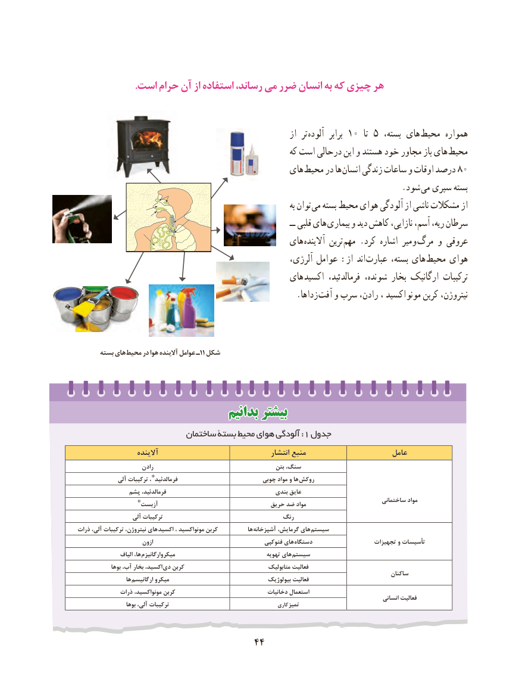

# PDF page 52

.است حرام آن از استفاده رساند، می ضرر انسان به که چیزی هر

                                                               از  تر آلوده۱۰برابر    تا۵ ،هایبسته          محیط همواره
                                                          که است درحالی این و هستند خود مجاور باز های محیط
                                              های محیط در ها ­انسان۸۰زندگی ساعات و اوقات درصد
                                                                              .شود ­ می سپری بسته
                                                                                  به توان می بسته محیط هوای آلودگی از ناشی مشکالت از
                                                                             ــ  قلبی های  بیماری و دید کاهش نازایی، آسم، ریه، سرطان
                                              های آالینده ترین مهم .کرد اشاره میر و مرگ و عروقی
                                                        آلرژی، عوامل :از اند عبارت بسته، های محیط هوای
                                              های اکسید فرمالدئید، شونده، بخار ارگانیک ترکیبات
                   . زداها آفت و سرب رادن، ، اکسید مونو کربن نیتروژن،

      بسته های محیط در هوا آالینده عوامل ـ11 شکل

                              بدانیمبدانیم بیشتربیشتر
                         ساختمان بستۀ محیط هوای آلودگی :1 جدول
                   آالینده                                    انتشار منبع                      عامل
                      رادن                                           بتن سنگ،
              آلی ترکیبات ، * فرمالدئید                         چوبی مواد و ها روکش
              پشم فرمالدئید،                                   بندی عایق
                  *                                                                                ساختمانی مواد                  آزبست                                حریق ضد مواد
                   آلی ترکیبات                                 رنگ
ذرات آلی، ترکیبات نیتروژن، های اکسید ، مونواکسید کربن            ها آشپزخانه گرمایش، های سیستم
                       ازون                                     فتوکپی های دستگاه                    تجهیزات و تأسیسات
                 الیاف ها، میکروارگانیزم                                  تهویه های سیستم
              بوها آب، بخار اکسید، دی کربن                              متابولیک فعالیت
                                                                                                         ساکنان
                   ها ارگانیسم میکرو                                  بیولوژیک فعالیت
              ذرات مونواکسید، کربن                                دخانیات استعمال
                                                                                                                  انسانی فعالیت
                    بوها آلی، ترکیبات                                        کاری تمیز

                                 4444

