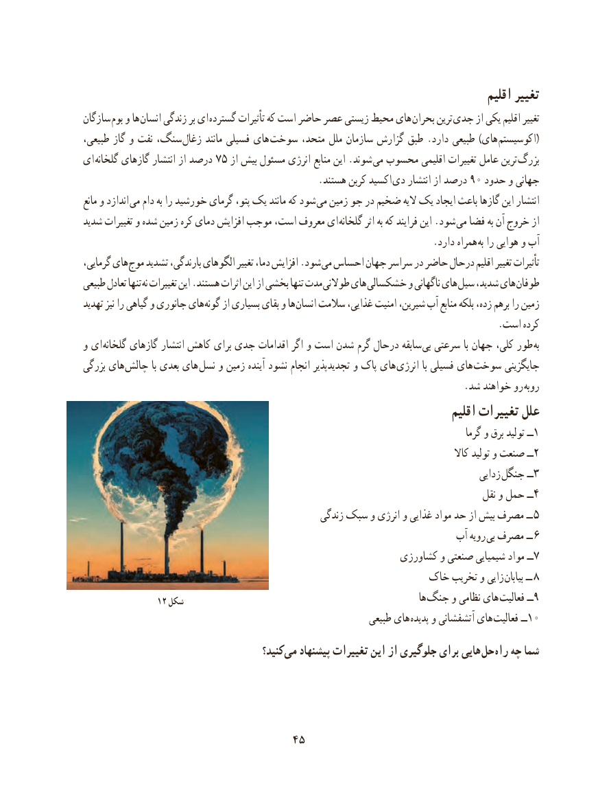

# PDF page 53

اقلیم تغییر
سازگان بوم و ها  انسان زندگی بر ای گسترده تأثیرات که است حاضر عصر زیستی محیط های بحران ترین جدی از یکی اقلیم تغییر
طبیعی، گاز و نفت سنگ، زغال مانند فسیلی های سوخت متحد، ملل سازمان گزارش طبق .دارد طبیعی )های (اکوسیستم
ای گلخانه٥گازهای انتشار از درصد ٧  از بیش مسئول انرژی منابع این .شوند می محسوب اقلیمی تغییرات عامل ترین بزرگ
                                                 .هستند کربن اکسید دی٩جهانیانتشار از درصد ٠ حدود و
مانع و اندازد  می دام به را خورشید گرمای پتو، یک مانند که شود  می زمین جو در ضخیم الیه یک ایجاد باعث گازها این انتشار
شدید تغییرات و شده زمین کره دمای افزایش موجب است، معروف ای  گلخانه اثر به که فرایند این .شود می فضا به آن خروج از
                                                                         .دارد همراه به را هوایی و آب
گرمایی، های موج تشدید بارندگی، الگوهای تغییر دما، افزایش .شود می احساس جهان سراسر در حاضر درحال اقلیم تغییر تأثیرات
طبیعی تعادل تنها نه تغییرات این .هستند اثرات این از بخشی تنها مدت طوالنی های خشکسالی و ناگهانی های سیل شدید، های طوفان
تهدید نیز را گیاهی و جانوری های گونه از بسیاری بقای و ها انسان سالمت غذایی، امنیت شیرین، آب منابع بلکه زده، برهم را زمین
                                                                                       .است کرده
و ای  گلخانه گازهای انتشار کاهش برای جدی اقدامات اگر و است شدن گرم درحال سابقه بی سرعتی با جهان کلی، طور به
بزرگی های  چالش با بعدی های  نسل و زمین آینده نشود انجام تجدیدپذیر و پاک های  انرژی با فسیلی های  سوخت جایگزینی
                                                                               .شد خواهند رو روبه
                                                                            اقلیم تغییرات علل
                                                                                                  گرما و برق تولید ١ــ
                                                                                                     کاال تولید و صنعت ٢ــ
                                                                                             زدایی جنگل ٣ــ
                                                                                          نقل و حمل ٤ــ
                                                   زندگی سبک و انرژی و غذایی مواد حد از بیش مصرف ــ 5
                                                                   آب رویه بی مصرف ــ ٦
                                                           کشاورزی و صنعتی شیمیایی مواد ٧ــ
                                                  خاک تخریب و زایی بیابان ــ ٨
               ١٢ شکل                                                              ها جنگ و نظامی های فعالیت٩ــ
                                                               طبیعی های  پدیده و آتشفشانی های فعالیت ١ــ0
                                          کنید؟ می پیشنهاد تغییرات این از جلوگیری برای هایی حل راه چه شما

                                 4545

