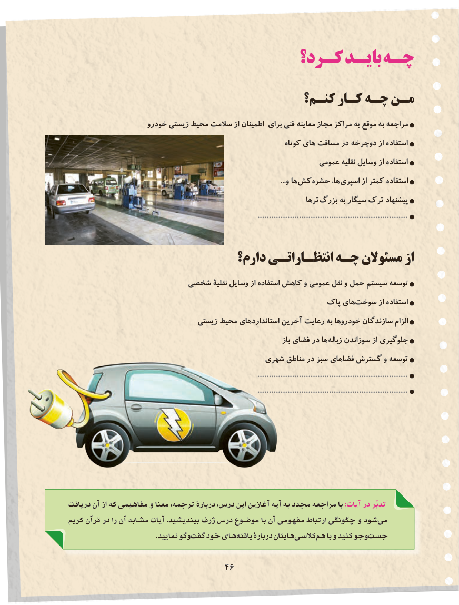

# PDF page 54

كـرد؟ بایـد چـه
                                     کنـم؟ کـار چـه مـن
                    خودرو زیستی محیط سالمت از اطمینان برای فنی معاینه مجاز مراكز به موقع به مراجعه
                                                                   کوتاه های مسافت در دوچرخه از استفاده
                                                             عمومی نقلیه وسایل از استفاده
                                                                                                                           ...و ها کش حشره ها، اسپری از کمتر استفاده
                                                                         ترها بزرگ به سیگار ترک پیشنهاد
                                                                                  .................................................................

                             دارم؟ انتظـاراتـی چـه مسئوالن از
                     شخصی نقلیۀ وسایل از استفاده كاهش و عمومی نقل و حمل سیستم توسعه
                                                         پاک هایسوخت‌        از استفاده
                                زیستی محیط استانداردهای آخرین رعایت به خودروها سازندگان الزام
                                                                               باز فضای در ها زباله سوزاندن از جلوگیری
                                         شهری مناطق در سبز فضاهای گسترش و توسعه
                                                                                  .................................................................
                                                                                  .................................................................

دريافت آن از كه مفاهيمي و معنا ترجمه، دربارۀ درس، اين آغازين آيه به مجدد مراجعه با :آیات در تدبّر
كريم قرآن در را آن مشابه آيات .بينديشيد ژرف درس موضوع با آن مفهومی ارتباط چگونگی و شود می
                                            .نماييد وگو گفت خود های يافته دربارۀ هايتان كالسی هم با و كنيد وجو جست

                                 4646

