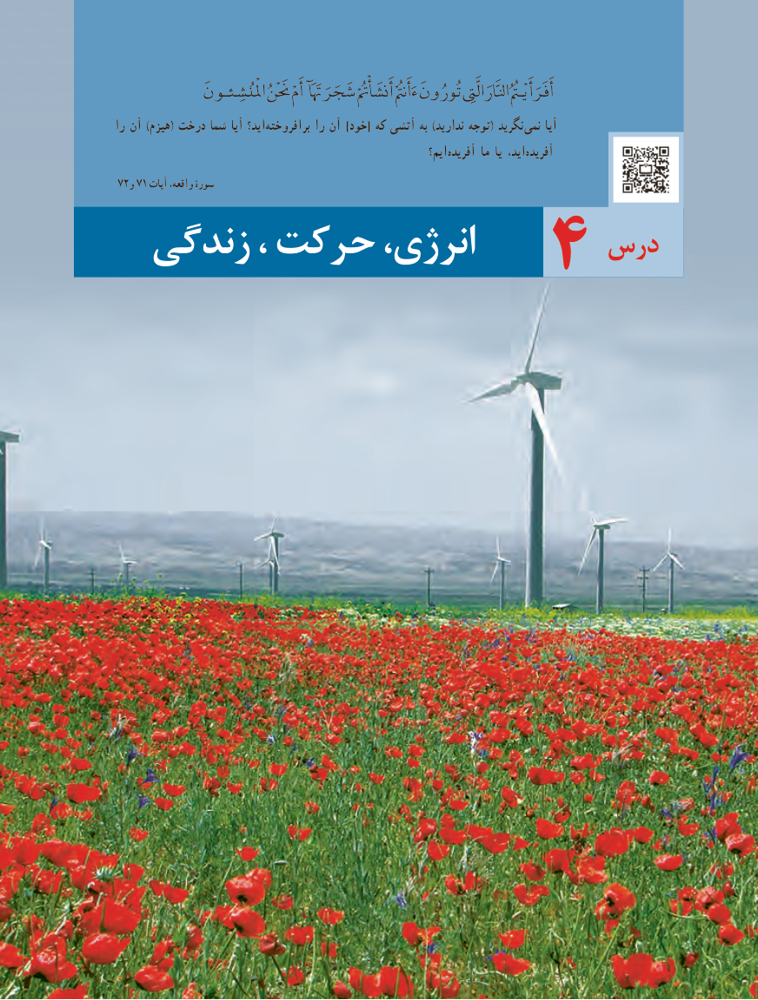

# PDF page 55

امْلُْنشِئـون حَنَْنُ أَمْ شَجَرَهَتََآ أَنشَأْمُتُْ ءَأَنمُتُْ تُورُونَ الَّیِتِ انلَّارَ أَفَرَأَيْـمُتُُ
را   آن )هیزم( درخت شما آیا اید؟ برافروخته را آن ]خود[ که آتشی به )ندارید توجه( نگرید نمی آیا
                                                                   ایم؟ آفریده ما یا اید، آفریده
72و 71 آیات واقعه، سورۀ
                            درس  زندگی ، حرکت انرژی،           4

                               4747

