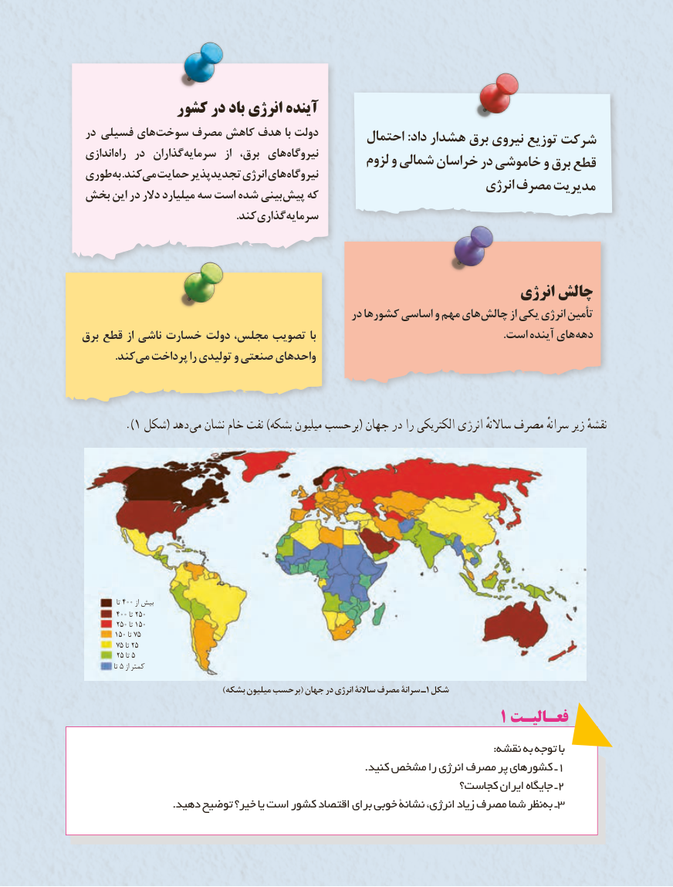

# PDF page 56

کشور در باد انرژی آینده
 در   فسیلی های سوخت مصرف کاهش هدف با دولت                                            احتمال :داد هشدار برق نیروی توزیع شرکت اندازی راه در  گذاران سرمایه  از  برق، های نیروگاه                                                لزوم و شمالی خراسان در خاموشی و برق قطعطوری به .کند می حمایت تجدیدپذیر انرژی های نیروگاه                                                                    انرژی مصرف مدیریتبخش این در دالر میلیارد سه است شده بینی پیش که
      . کند گذاریسرمایه

                                                                انرژی چالش
                                                 در کشورها اساسی و مهم های چالش از یکی انرژی تأمین
برق قطع از ناشی خسارت دولت مجلس، تصویب با     . است آینده هایدهه
   . کندمی پرداخت را تولیدی و صنعتی واحدهای

        .)1 شکل( دهد می نشان خام نفت )بشکه میلیون حسب بر( جهان در را الکتریکی انرژی ساالنهٴ مصرف سرانهٴ زیر نقشهٴ

                 تا 400 از بیش
         400 تا 250
         250 تا 150
         150 تا 75
         75 تا 25
         25 تا 5
                تا 5 از کمتر
                                         )بشکه میلیون حسب بر۱( جهان در انرژی ساالنۀ مصرف سرانۀ ـ شکل
                                                              1 فعـالیـت
                                                                                                                      :نقشه به توجه با
   .1کنید مشخص را انرژی مصرف پر کشورهای ـ
                                                           کجاست؟ ایران جایگاه ـ2
                          .دهید توضیح خیر؟ یا است کشور اقتصاد برای خوبی نشانۀ انرژی، زیاد مصرف شما نظر به ـ3
                                 4848

