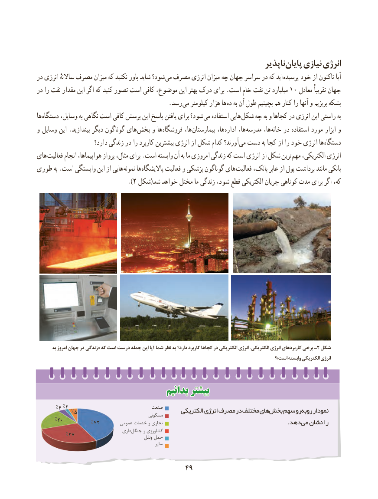

# PDF page 57

ناپذیر پایان نیازی انرژی
در انرژی ساالنهٔ مصرف میزان که نکنید باور شاید شود؟ می مصرف انرژی میزان چه جهان سراسر در که اید پرسیده خود از تاکنون آیا
در را نفت مقدار این اگر که کنید تصور است کافی موضوع، این بهتر درک برای .است خام نفت تن میلیارد ۱0 معادل تقریباً جهان
                 . رسد می کیلومتر هزار ها ده به آن طول بچینیم هم کنار را آنها و بریزیم بشکه
ها  دستگاه وسایل، به نگاهی است کافی پرسش این پاسخ یافتن برای شود؟  می استفاده هایی شکل چه به و کجاها در انرژی این راستی به
و وسایل این .بیندازید دیگر گوناگون های بخش و ها فروشگاه ها،  بیمارستان ها، اداره ها، مدرسه ها، خانه در استفاده مورد ابزار و
                      دارد؟ زندگی در را کاربرد بیشترین انرژی از شکل کدام آورند؟ می دست به کجا از را خود انرژی ها دستگاه
های  فعالیت انجام هواپیماها، پرواز مثال، برای .است وابسته آن به ما امروزی زندگی که است انرژی از شکل ترین  مهم الکتریکی، انرژی
طوری به .است وابستگی این از هایی نمونه ها پاالیشگاه فعالیت و پزشکی گوناگون های  فعالیت بانک، عابر از پول برداشت مانند بانکی
                              ).2 شکل(شد خواهد مختل ما زندگی شود، قطع الکتریکی جریان کوتاهی مدت برای اگر که،

        به امروز جهان در زندگی«  که است درست جمله این آیا شما نظر به دارد؟ کاربرد کجاها در الکتریکی انرژی .الکتریکی انرژی کاربردهای برخی ـ۲ شکل
                                                                                                             ؟»است وابسته الکتریکی انرژی

                                    بدانیمبدانیم بیشتربیشتر
      %4 %2                             صنعت           %5                                    الکتریکی انرژی مصرف در مختلف هایبخش    سهم روروبه     نمودار                                              مسکونی
      %20                  %42        عمومی خدمات و تجاری                 . دهدمی نشان را
                                       داری  جنگل و کشاورزی         %27                                                   ونقل حمل
                                                            سایر

                                      4949

