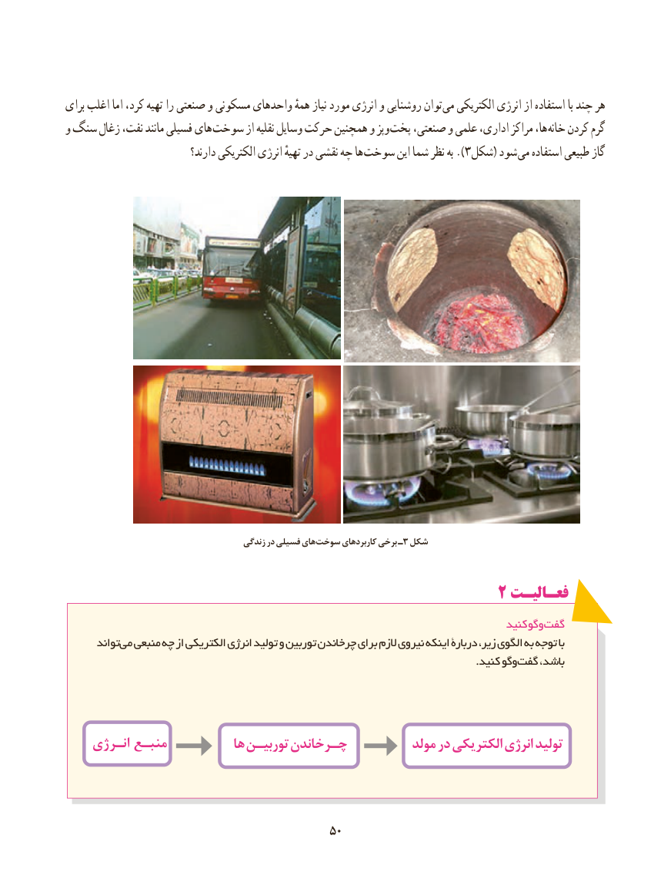

# PDF page 58

برای اغلب اما کرد، تهیه را صنعتی و مسکونی واحدهای همهٔ نیاز مورد انرژی و روشنایی توان می الکتریکی انرژی از استفاده با چند هر
و سنگ زغال نفت، مانند فسیلی های سوخت از نقلیه وسایل حرکت همچنین و وپز پخت صنعتی، و علمی اداری، مراکز ها، خانه کردن گرم
                              دارند؟ الکتریکی انرژی تهیهٔ در نقشی چه ها ).سوخت این شما نظر به  3شکل( شود می استفاده طبیعی گاز

                                        زندگی در فسیلی های سوخت کاربردهای برخی ـ3 شکل

                                                  2 فعـالیـت
                                                                                  کنید وگو گفت
       تواند می منبعی چه از الکتریکی انرژی تولید و توربین چرخاندن برای الزم نیروی اینکه دربارۀ زیر، الگوی به توجه با
                   . کنید وگوگفت باشد،

    انـرژیانـرژی منبـعمنبـع           هاها توربیـنتوربیـن چـرخاندنچـرخاندن           مولدمولد دردر الکتریکیالکتریکی یانرژیانر تولیدتولید

                                           5050

