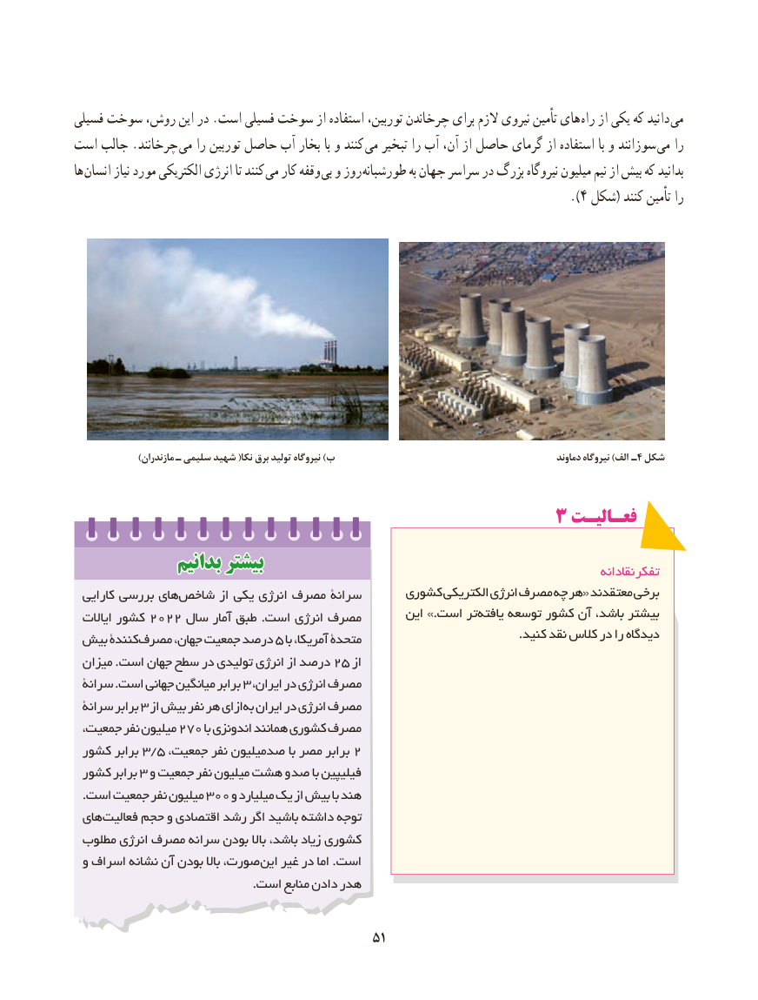

# PDF page 59

فسیلی سوخت روش، این در .است فسیلی سوخت از استفاده توربین، چرخاندن برای الزم نیروی تأمین های راه از یکی که دانید  می
است جالب .چرخانند  می را توربین حاصل آب بخار با و کنند می تبخیر را آب آن، از حاصل گرمای از استفاده با و سوزانند  می را
ها انسان نیاز مورد الکتریکی انرژی تا کنند می کار وقفه بی و روز  طورشبانه به جهان سراسر در بزرگ نیروگاه میلیون نیم از بیش که بدانید
                                                                                                 ).4 شکل( کنند تأمین را

                 )مازندران ـ سلیمی شهید (نکا برق تولید نیروگاه )ب                                                      دماوند نیروگاه )الف ـ4 شکل

                                        3 فعـالیـت
              بدانیمبدانیم بیشتربیشتر                                                                    نقادانه تفکر
  کارایی بررسی های شاخص از یکی انرژی مصرف سرانۀ      کشوری الکتریکی انرژی مصرف چه هر« معتقدند برخی
                                                       این .»است تر یافته توسعه کشور آن باشد، بیشتر  ایاالت کشور ٢٢٠٢ سال آمار طبق .است انرژی مصرف
                                                                                                                 .کنید نقد کالس در را دیدگاه بیش کنندۀ مصرف۵جهان، جمعیت درصد   با آمریکا، متحدۀ
 میزان .است جهان سطح در تولیدی انرژی از درصد ۲۵ از
 سرانۀ .است جهانی میانگین برابر ۳ ،مصرفایران در انرژی
 سرانۀ برابر ٣ از بیش نفر هر ازای به ایران در انرژی مصرف
 جمعیت، نفر میلیون 270 با اندونزی همانند کشوری مصرف
 کشور برابر 3/5 ،جمعیت نفر صدمیلیون با مصر برابر 2
 کشور٣برابر  و جمعیت نفر میلیون هشت و صد با فیلیپین
  .است جمعیت نفر میلیون 300 و میلیارد یک از بیش با هند
 های فعالیت حجم و اقتصادی رشد اگر باشید داشته توجه
 مطلوب انرژی مصرف سرانه بودن باال باشد، زیاد کشوری
 و اسراف نشانه آن بودن باال صورت، این غیر در اما .است
                                             .است منابع دادن هدر

                                           5151

