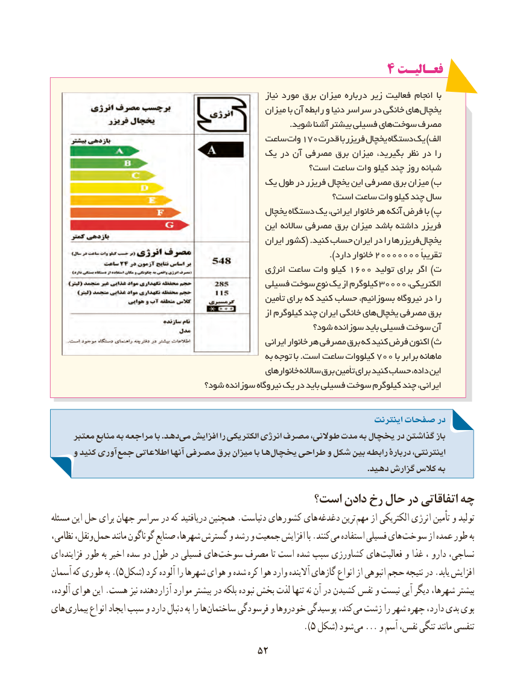

# PDF page 60

4 فعـالیـت
                                                                  نیاز مورد برق میزان درباره زیر فعالیت انجام با
                                                   میزان با آن رابطه و دنیا سراسر در خانگی های یخچال
                                                                                       .شوید آشنا بیشتر فسیلی های سوخت مصرف
                                        ساعت وات 170قدرت با فریزر یخچال دستگاه یک )الف
                                     یک در آن مصرفی برق میزان بگیرید، نظر در را
                                                است؟ ساعت وات کیلو چند روز شبانه
                                    یک طول در فریزر یخچال این مصرفی برق میزان )ب
                                                    است؟ ساعت وات کیلو چند سال
                                                 یخچال دستگاه یک ایرانی، خانوار هر آنکه فرض با )پ
                                                   این ساالنه مصرفی برق میزان باشد داشته فریزر
                                                        ایران کشور( .کنید حساب ایران در را فریزرها یخچال
                               ).20000000دارد خانوار                ًتقریبا
                                                     انرژی ساعت وات کیلو 1600 تولید برای اگر )ت
                                           فسیلی سوخت نوع یک از کیلوگرم 30000 ،الکتریکی
                                                      تأمین برای که کنید حساب بسوزانیم، نیروگاه در را
                                                               از کیلوگرم چند ایران خانگی های یخچال مصرفی برق
                                                     شود؟ سوزانده باید فسیلی سوخت آن
                                                            ایرانی خانوار هر مصرفی برق که کنید فرض اکنون )ث
                                                      به توجه با .است ساعت کیلووات 700 با برابر ماهانه
                                                         خانوارهای ساالنه برق تأمین برای کنید حساب داده، این
                               شود؟ سوزانده نیروگاه یک در باید فسیلی سوخت کیلوگرم چند ایرانی،

                                                                               اینترنت صفحات در
     معتبر منابع به مراجعه با .دهد می افزایش را الکتریکی انرژی مصرف طوالنی، مدت به یخچال در گذاشتن باز
     و کنید آوری جمع اطالعاتی آنها مصرفی برق میزان با ها یخچال طراحی و شکل بین رابطه دربارۀ اینترنتی،
                                                                                                                                          .دهید گزارش کالس به
                                     است؟ دادن رخ حال در اتفاقاتی چه
مسئله این حل برای جهان سراسر در که دریافتید همچنین .دنیاست کشورهای های  دغدغه ترین مهم از الکتریکی انرژی تأمین و تولید
نظامی، ونقل، حمل مانند گوناگون صنایع شهرها، گسترش و رشد و جمعیت افزایش با .کنند می استفاده فسیلی های سوخت از عمده طور به
ای فزاینده طور به اخیر سده دو طول در فسیلی های سوخت مصرف تا است شده سبب کشاورزی های فعالیت و غذا ، دارو نساجی،
آسمان که طوری به ).5 شکل( کرد آلوده را شهرها هوای و شده کره هوا وارد آالینده گازهای انواع از انبوهی حجم نتیجه در .یابد افزایش
آلوده، هوای این .هست نیز دهنده آزار موارد بیشتر در بلکه نبوده بخش لذت تنها نه آن در کشیدن نفس و نیست آبی دیگر شهرها، بیشتر
های بیماری انواع ایجاد سبب و دارد دنبال به را ها ساختمان فرسودگی و خودروها پوسیدگی کند، می زشت را شهر چهره دارد، بدی بوی
                                                             ).5 شکل( شود می ... و آسم نفس، تنگی مانند تنفسی
                                     5252

