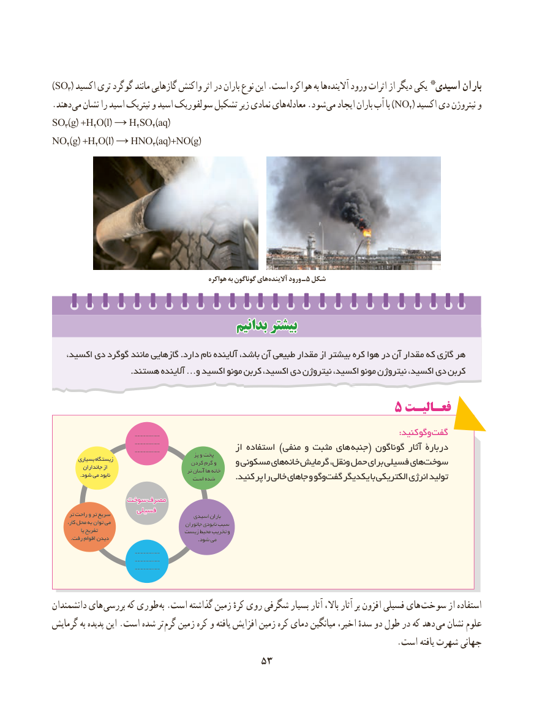

# PDF page 61

)SO3( اکسید تری گوگرد مانند گازهایی واکنش اثر در باران نوع این .است هواکره به ها آالینده ورود اثرات از دیگر یکی  *اسیدی باران
. دهند می نشان را اسید نیتریک و اسید سولفوریک تشکیل زیر نمادی های معادله .شود )می ایجاد باران آب با NO2( اکسید دی نیتروژن و
SO3(g) +H2O(l) → H2SO4(aq)
NO2(g) +H2O(l) → HNO3(aq)+NO(g)

                                                   هواکره به گوناگون های آالینده ورود ـ ٥ شکل

                                    بدانیمبدانیم بیشتربیشتر

      ،اکسيد دي گوگرد مانند گازهايي .دارد نام آالینده ،هر‌باشد آن طبيعي مقدار از بيشتر کره هوا در آن مقدار که گازي
                            .هستند آالینده …و اکسيد مونو کربن اکسيد، دي نيتروژن اکسيد، مونو نيتروژن اکسيد، دي کربن

                                             ۵ فعـالیـت
                                                     ................              : کنید وگوگفت
                                                     ................                                                     ................                     از استفاده ) منفی و مثبت های  جنبه ( گوناگون آثار دربارۀ                                                          پز و پخت          بسیاری زیستگاه                                              کردن گرم و    و مسکونی های خانه گرمایش ونقل، حمل برای فسیلی های سوخت             جانداران از                                                        تر آسان ها خانه                .شود می نابود                                      است شده . کنید پر را خالی جاهای و وگوگفت یکدیگر با الکتریکی انرژی تولید

               سوختسوخت مصرفمصرف
                     فسیلیفسیلی       تر راحت و تر سریع                           اسیدی باران
        کار، محل به توان می                               جانوران نابودی سبب
                یا تفریح                        زیست محیط تخریب و
           .رفت اقوام دیدن                                                    .شود می
                                                     ................
                                                     ................
                                                     ................

دانشمندان های بررسی که طوری  به .است گذاشته زمین کرهٔ روی شگرفی بسیار آثار باال، آثار بر افزون فسیلی های  سوخت از استفاده
گرمایش به پدیده این .است شده تر  گرم زمین کره و یافته افزایش زمین کره دمای میانگین اخیر، سدهٔ دو طول در که دهد می نشان علوم
                                                                                 .است یافته شهرت جهانی
                                  5353

