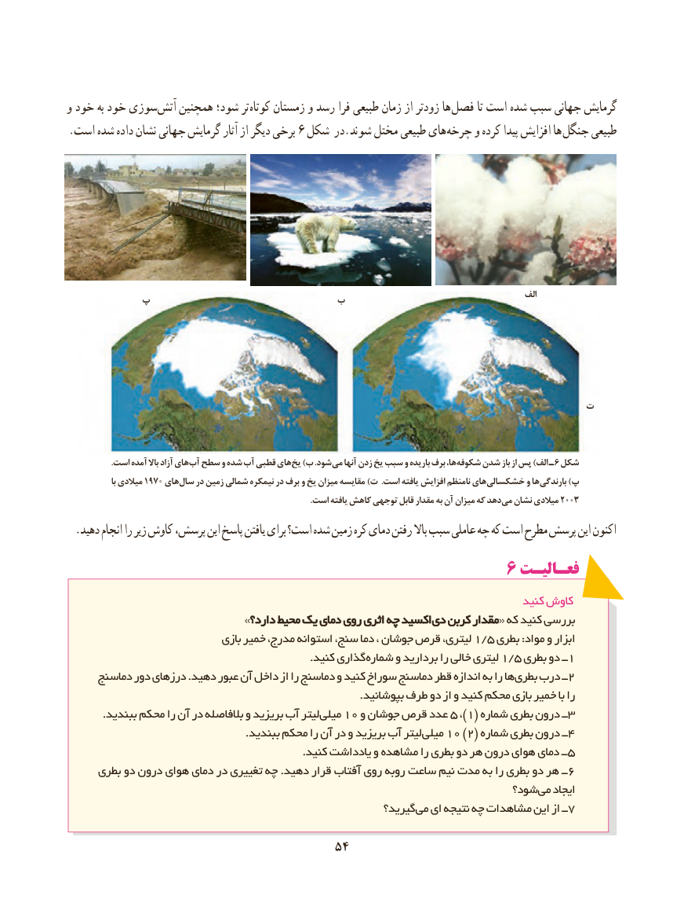

# PDF page 62

و خود به خود سوزی آتش همچنین شود؛ تر کوتاه زمستان و رسد فرا طبیعی زمان از زودتر ها فصل تا است شده سبب جهانی گرمایش
.6است شده داده نشان جهانی گرمایش آثار از دیگر برخی  شکل در.شوند مختل طبیعی های چرخه و کرده پیدا افزایش ها جنگل طبیعی

                                                                                                                  الف         پ                       ب

                                                                 ت

                     .است آمده باال آزاد های آب سطح و شده آب قطبی های یخ )ب .شود می آنها زدن یخ سبب و باریده برف ها، شکوفه شدن باز از پس )الف ـ 6 شکل
                  با میالدی 1970 های سال در زمین شمالی نیمکره در برف و یخ میزان مقایسه )ت .است یافته افزایش نامنظم های خشکسالی و ها بارندگی )پ
                                                                                                                  .است یافته کاهش توجهی قابل مقدار به آن میزان که دهد می نشان میالدی 2003
  .دهید انجام را زیر کاوش پرسش، این پاسخ یافتن برای است؟ شده زمین کره دمای رفتن باال سبب عاملی چه که است مطرح پرسش این اکنون
                                             6 فعـالیـت
                                                                                   کنید کاوش
                              »دارد؟دارد؟ محیطمحیط یکیک دمایدمای رویروی اثریاثری چهچه اکسیداکسید  دیدی کربنکربن مقدارمقدار« که کنید بررسی
                                بازی خمیر مدرج، استوانه سنج، دما ، جوشان قرص لیتری، 1/5 بطری :مواد و ابزار
        . کنید گذاریشماره و بردارید را خالی لیتری 1/5 بطری دو ــ 1
     دماسنج دور درزهای .دهید عبور آن داخل از را دماسنج و کنید سوراخ دماسنج قطر اندازه به را ها بطری درب ــ2
                                                                                  .بپوشانید طرف دو از و کنید محکم بازی خمیر با را
. ببندید محکم را آن در بالفاصله و بریزید آب لیترمیلی 10 و جوشان قرص عدد 5 ،)1( شماره بطری درون ــ 3
                                                  .ببندید محکم را آن در و بریزید آب لیتر میلی١٠ )2( شماره بطری درون ــ 4
                                                                  .کنید یادداشت و مشاهده را بطری دو هر درون هوای دمای ــ 5
     بطری دو درون هوای دمای در تغییری چه .دهید قرار آفتاب روی روبه ساعت نیم مدت به را بطری دو هر ــ ٦
                                                                      شود؟ می ایجاد
                                                           گیرید؟ می ای نتیجه چه مشاهدات این از ــ 7

                                    5454

